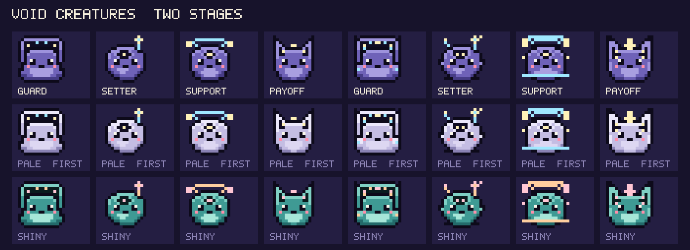
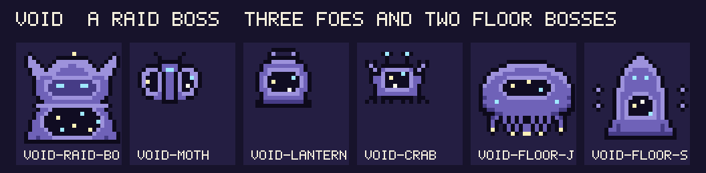
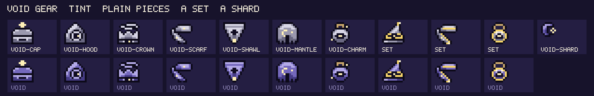
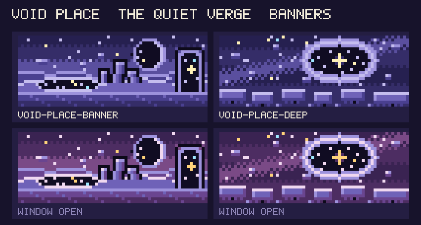
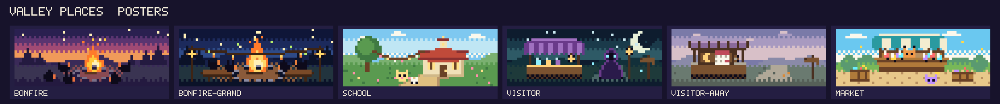
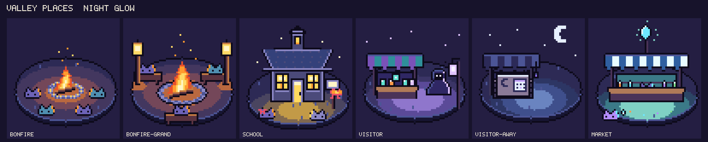
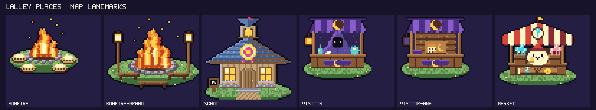

# Art library

<!-- Generated by `pnpm art library` from apps/activity/src/sprites/concepts/. Do not edit by hand; `pnpm check` fails when it is out of date. -->

Art drawn ahead of its content: creatures, bosses, items and banners that have no name or stats yet. **Before adding content, look here** for art that was made for it, and use it (move the sprite into `apps/activity/src/sprites/data/` under the content id and delete the concept in the same PR). To add art, see `docs/design/art-studio.md`.

Status: **liked** means Misa approved the look; **draft** means he has not said yet; **redo** means he wants changes first (see the notes).

| Set | Status | Pieces | Requested |
| --- | --- | --- | --- |
| [Void creatures, two stages](#void) | liked | 8 | 2026-10-30: imagine the Void element on creatures; four creatures, one per role, no names or stats. |
| [Void, a raid boss, three foes and two floor bosses](#void-foes) | draft | 6 | 2026-10-31: a Void raid boss, dungeon foes and dungeon bosses. |
| [Void gear: tint, plain pieces, a set, a shard](#void-gear) | draft | 11 | 2026-10-31: design Void gear. |
| [Void place, the Quiet Verge (banners)](#void-place) | liked | 2 | 2026-10-31: design a Void area that can be explored (banner and place). |
| [Valley places: posters](#valley-posters) | draft | 6 | 2026-10-31: the bonfire, the School, the weekly visitor and the Market, in the direction of the expedition map art; try variations. |
| [Valley places: night glow](#valley-night) | draft | 6 | 2026-10-31: the bonfire, the School, the weekly visitor and the Market, in the direction of the expedition map art; try variations. |
| [Valley places: map landmarks](#valley-landmarks) | draft | 6 | 2026-10-31: the bonfire, the School, the weekly visitor and the Market, in the direction of the expedition map art; try variations. |

## Void creatures, two stages

- **Status:** liked
- **Requested:** 2026-10-30: imagine the Void element on creatures; four creatures, one per role, no names or stats.
- **Element:** void
- **Source:** `apps/activity/src/sprites/concepts/void.ts` (draw it with `pnpm art void`)
- **Sheet of:** `bf4737245b93`
- Misa chose the dark purple body over the pale first draft and said they look pretty good (2026-10-30).
- Needs before use: the Void element in the content (element chart, marks, a place), names, stats, lore, shiny palettes.
- The payoff's ear windows are the faintest detail; look again when it is promoted.

| Code | Kind | Role | Status | Idea |
| --- | --- | --- | --- | --- |
| `void-guard` | creature | guard | liked | An eclipse hood: a wide dark crescent of night sky over a sturdy body, like a shield. |
| `void-setter` | creature | setter | liked | A floating wisp with a feeler that ends in a star: it points at the boss and marks it. |
| `void-support` | creature | support | liked | A small planet with a ring for a halo and two moons in orbit: it lifts its neighbours. |
| `void-payoff` | creature | payoff | liked | A lynx of the night: tall ears that are windows full of stars, a star-tipped crest. |
| `void-guard-2` | creature | guard | draft | The Eclipse Hood grown: horned corners, a second star and a cyan corona in the window, raised shoulder plates with a glint. |
| `void-setter-2` | creature | setter | draft | The star-feeler wisp grown: a second small feeler, a wider third-eye window with two stars, side wisps and a trailing tail. |
| `void-support-2` | creature | support | draft | The ringed planet grown: a double halo, bigger moons, a third moon and the ring wrapped round its belly. |
| `void-payoff-2` | creature | payoff | draft | The night lynx grown: wider ear windows with two stars, a star-shaped crest and a cheek ruff. |

## Void, a raid boss, three foes and two floor bosses

- **Status:** draft
- **Requested:** 2026-10-31: a Void raid boss, dungeon foes and dungeon bosses.
- **Element:** void
- **Source:** `apps/activity/src/sprites/concepts/void-foes.ts` (draw it with `pnpm art void-foes`)
- **Sheet of:** `e086da4e04e7`
- Needs before use: the Void element in the content, names, stats, gimmicks, lore and a place.
- Working names and ideas are in docs/compendium/bosses.md and dungeon.md ("Concept, not shipped").
- 2026-10-31 (Misa): void-crab, "More emphasis on the claws"; redrawn with big raised claws that dominate the silhouette.
- 2026-10-31 (Misa): void-floor-sentinel, "Make it more animate"; redrawn as a living stone guardian (horns, face, one fist raised, mid-step).
- 2026-10-31 (Misa): void-lantern, "You don't generally fight lanterns (inanimate)"; replaced by void-angler, a living fish that carries a lantern lure.
- 2026-10-31 (Misa): void-moth, "Make it more pointy and elegant"; redrawn with swept, pointed wings, a slender body and antennae.

| Code | Kind | Role | Status | Idea |
| --- | --- | --- | --- | --- |
| `void-raid-boss` | boss |  | draft | Hollow Crown: a huge hooded giant under a crescent crown, two glinting eyes in the hood and a cloak that opens on a starfield. |
| `void-moth` | foe |  | draft | Dusk Moth: swept, pointed wings with a starry window each, a slender body and long curved antennae; it eats light. |
| `void-angler` | foe |  | draft | Gloam Angler: a round deep-dark fish with a starry window on its flank, a glinting eye, a toothy mouth and a lure on a stalk that holds one warm star; it hides what its light touches. |
| `void-crab` | foe |  | draft | Drift Crab: a crab with two huge raised claws that fill the silhouette, a starry window in its shell and glinting eyes; it tucks in and hides. |
| `void-floor-jelly` | boss |  | liked | Lantern Drifter: a floating bell with a starry window, two glinting eyes and trailing tendrils tipped with stars. |
| `void-floor-sentinel` | boss |  | draft | Dim Sentinel: a living stone guardian with horns and glinting eyes, one fist raised and one hanging, mid-step, a doorway of night in its belly and two shards orbiting it. |

## Void gear: tint, plain pieces, a set, a shard

- **Status:** draft
- **Requested:** 2026-10-31: design Void gear.
- **Element:** void
- **Source:** `apps/activity/src/sprites/concepts/void-gear.ts` (draw it with `pnpm art void-gear`)
- **Sheet of:** `c0d5c4c25d5e`
- Needs before use: the Void element in the content (an element tag, a Void Hat, Scarf and Charm at three tiers in gear.json, the set in gear-sets.json, a Void shard in the part kinds), the tint in TINTS and SET_TINTS (gear-sprites.ts), names and flavour confirmed, and the charm flair in item-flair.ts.
- Proposed tint: t #7468bc, u #463c86, h #b4aae8 (the Void creatures, a little lighter so a dark item stands out on the panels).
- 2026-10-31: Misa liked the other eight; for the Starkeeper's set (hat, scarf, charm) he said it read pure purple and yellow and asked for a small accent toward the stars. Added a fixed pale starlight cyan `#9fe8ff` (not tinted) on the stars and a glint on the trim; silhouettes and gold trim kept. Those three are draft again.
- The charm is the shared trail-charm with a Void flair (the variant); every other piece is its own look, as the shipped hats and scarves are.

| Code | Kind | Role | Status | Idea |
| --- | --- | --- | --- | --- |
| `void-cap` | item |  | liked | Dusk Cap: a round cap with a star on a stalk and a band of starry window. |
| `void-hood` | item |  | liked | Gloaming Hood: a pointed cloth hood; inside it shows a round window of night with one star. |
| `void-crown` | item |  | liked | Stargazer's Crown: a three-point crown with a tilted ring in orbit around its tips and a star in its window. |
| `void-scarf` | item |  | liked | Twilight Scarf: a soft wound scarf with a star on the band and one long tail, notched at the end. |
| `void-shawl` | item |  | liked | Nightfall Shawl: a triangle of cloth hanging to a point, a lit window across the chest, a star at the tip. |
| `void-mantle` | item |  | liked | Stargazer's Mantle: sloping shoulders, a collar, a crescent clasp, a front seam and a scalloped hem. |
| `void-charm` | item |  | liked | Starwell Charm: the shared trail-charm with a Void flair (a window with a star, and a glint); the variant is the plain shipped stone. |
| `void-set-hat` | item | set | draft | Starkeeper's Hat: a tall pointed hat with a gold star at the tip and a gold band round a starry window. |
| `void-set-scarf` | item | set | draft | Starkeeper's Loop: a gold-striped wound scarf with a long tail, a star on it and a gold tassel. |
| `void-set-charm` | item | set | draft | Starkeeper's Lens: a gold ring, like a lens held up to the sky, with a starry window inside. |
| `void-shard` | part |  | liked | Void shard: a crescent-shaped crystal with a star caught in its hollow. |

## Void place, the Quiet Verge (banners)

- **Status:** liked
- **Requested:** 2026-10-31: design a Void area that can be explored (banner and place).
- **Element:** void
- **Source:** `apps/activity/src/sprites/concepts/void-place.ts` (draw it with `pnpm art void-place`)
- **Sheet of:** `daa071502d5a`
- Misa liked both banners on the art review page (2026-10-31).
- Place concept: docs/compendium/places.md, "Quiet Verge" (working name). Concept, not shipped.
- Needs before use: the Void element in the content (element chart, marks, creatures from void.ts with names, stats, lore, shiny palettes), an entry in destinations.json with these palette colours and the deeper area, an access rule, journal pages, push-on flavour and a glossary entry, then the compendium entry moved out of concept.
- To ship: move the banners into data/ (a void-banner-sprites.ts registered in BANNER_SPRITE_DATA under the destination id) and delete this set.
- Each banner uses 11 colours or fewer (the studio cap), where shipped banners use 12 to 14.

| Code | Kind | Role | Status | Idea |
| --- | --- | --- | --- | --- |
| `void-place-banner` | banner |  | liked | The Quiet Verge: a dusk plain of lilac dust, a still pool that holds the stars, leaning stones, a dark moon and a stone arch with one warm star at the far end. |
| `void-place-deep` | banner |  | liked | The far side: the ground ends, stepping stones cross the open sky, and a great ring hangs ahead with one warm star at its middle. |

## Valley places: posters

- **Status:** draft
- **Requested:** 2026-10-31: the bonfire, the School, the weekly visitor and the Market, in the direction of the expedition map art; try variations.
- **Source:** `apps/activity/src/sprites/concepts/valley-posters.ts` (draw it with `pnpm art valley-posters`)
- **Sheet of:** `e7a08c426a3f`
- Direction "poster": six 64x24 banners, one per place state, each with its own time of day (dusk, night, morning, twilight, grey dawn, afternoon).
- Places: the bonfire (and a grander later level), the School, the weekly visitor (here and away), the Market (the shard broker). Designs are on the ccr-93a1de17-yutb1a branch, docs/design/valley/systems/.
- Needs before use: the valley places in the content, each place screen head using its banner; the visitor-away banner shows between Sunday and Thursday.
- Each banner uses up to 16 colours (the studio cap for scenes).
- Creatures in the banners are silhouettes or simple blobs, not species: swap in the player's own when the screen can.

| Code | Kind | Role | Status | Idea |
| --- | --- | --- | --- | --- |
| `bonfire` | banner |  | draft | A warm dusk: a fire in a ring of stones in the middle of the valley, four resting creatures as silhouettes with a firelight rim, sparks rising into a plum sky. |
| `bonfire-grand` | banner |  | draft | The grand hearth at night: a wider stone ring and a taller fire, a log bench each side with creatures on it, lantern posts with a string of lanterns, fireflies. |
| `school` | banner |  | draft | A bright morning: the schoolhouse with a bell tower at the end of a path, bunting from the tree, and a little graduate in front wearing a pink ribbon. |
| `visitor` | banner |  | draft | A blue-green twilight under a crescent moon: the hooded stranger with glowing eyes and a lantern staff beside his striped stall of glowing jars. |
| `visitor-away` | banner |  | draft | The same stall on a grey-lilac morning: awning furled, lantern dark, a leaf on the counter and a sign with a moon and a calendar page, one day marked. |
| `market` | banner |  | draft | A golden afternoon: a teal and cream stall where a round orange shopkeeper sells shards (red, yellow, cyan, violet), crates of them in front and a customer with a coin. |

## Valley places: night glow

- **Status:** draft
- **Requested:** 2026-10-31: the bonfire, the School, the weekly visitor and the Market, in the direction of the expedition map art; try variations.
- **Source:** `apps/activity/src/sprites/concepts/valley-night.ts` (draw it with `pnpm art valley-night`)
- **Sheet of:** `56eb7da8b49a`
- Direction "night glow": each place at dusk or night, lit by its own light (fire orange, window yellow, violet lamp, teal shard glow), warm stepped rings on the ground and cool blue-purple shadow.
- Each sprite is a 64x64 island vignette (kind free, 16 colours) in a 3/4 top-down view, made to sit in a valley map; the island rim keeps it readable on the dark panels.
- The creatures in these are small stand-ins (10x7), not species; the game would draw the player's own creatures there.
- Names on the signs, the ribbon and the shard colours follow the designs on the valley branch; the content needs the places to exist (V-BON, school, visitor, V-FORGE-11) before this art is used.

| Code | Kind | Role | Status | Idea |
| --- | --- | --- | --- | --- |
| `bonfire` | free |  | draft | A fire in the middle of the valley with four resting creatures around it, each lit orange on the fire side and cool on the back: the warm heart, room for a rotating few. |
| `bonfire-grand` | free |  | draft | The communal hearth at a later level: a taller fire in a paved stone ring, log benches with three creatures, and two lantern posts that throw their own small light. |
| `school` | free |  | draft | A small schoolhouse with lit windows and a bell cupola; a creature outside wears the graduation ribbon, and a rosette hangs on the sign. |
| `visitor` | free |  | draft | The weekly visitor: a hooded stranger with violet lamp-light on one edge and two teal-white eyes, beside a small stall whose wares glow. |
| `visitor-away` | free |  | draft | The same stall shuttered: a "back Thursday" board with a moon and a calendar mark, an unlit lamp with one last spark, a pale moon above. |
| `market` | free |  | draft | A stall where a creature trades shards: four element shards glow on the counter, a big shard is the sign, and a customer waits with one. |

## Valley places: map landmarks

- **Status:** draft
- **Requested:** 2026-10-31: the bonfire, the School, the weekly visitor and the Market, in the direction of the expedition map art; try variations.
- **Source:** `apps/activity/src/sprites/concepts/valley-landmarks.ts` (draw it with `pnpm art valley-landmarks`)
- **Sheet of:** `7de1609620d1`
- One of several directions for the four valley places; this one draws each as a map marker. Compare it with the other sets before picking.
- To use: the valley screen composes places from sprites; these are free sprites up to 64 px and would be shown at their drawn size on grass.
- The visitor and visitor-away drawings share a stall; the away sign is a calendar page and a moon, not words.

| Code | Kind | Role | Status | Idea |
| --- | --- | --- | --- | --- |
| `bonfire` | free |  | draft | A crackling fire in a stone ring on a patch of grass, with four straw beds around it: 'room for four resting creatures'. |
| `bonfire-grand` | free |  | draft | The later level: a wider flagstone ring, a taller fire, log benches on three sides and two lantern posts. |
| `school` | free |  | draft | A little blue-roofed schoolhouse with a bell cupola and a graduation rosette on the gable; a slate stands by the door. |
| `visitor` | free |  | draft | A hooded stranger with glowing eyes behind a purple-awninged stall, a crescent moon on the awning and a lit lantern. |
| `visitor-away` | free |  | draft | The same stall shuttered, lantern out, a sign with a calendar page and a moon: 'back Thursday'. |
| `market` | free |  | draft | A red and cream striped tent stall where a tiny creature in a cap trades shards from two crates; sign shows shard and coin. |
