# Art library

<!-- Generated by `pnpm art library` from apps/activity/src/sprites/concepts/. Do not edit by hand; `pnpm check` fails when it is out of date. -->

Art drawn ahead of its content: creatures, bosses, items and banners that have no name or stats yet. **Before adding content, look here** for art that was made for it, and use it (move the sprite into `apps/activity/src/sprites/data/` under the content id and delete the concept in the same PR). To add art, see `docs/design/art-studio.md`.

Status: **liked** means Misa approved the look; **draft** means he has not said yet; **redo** means he wants changes first (see the notes).

| Set | Status | Pieces | Requested |
| --- | --- | --- | --- |
| [Combat v2 icons: attack shapes, board states, store meters](#combat-icons) | draft | 11 | 2026-10-31, Misa: "icons for keywords and attack shapes" (roadmap phase 3, combat v2). |
| [House: the Cosy starter set](#house-cosy) | draft | 26 | 2026-11-09: player housing, art batch E4: the starter set mapped from the living room and its three new pieces. |
| [House: garden and pool pieces](#house-garden) | draft | 13 | 2026-11-09: player housing, art batch E4: twelve garden and pool pieces that sit on grass and by water and read from a distance. |
| [House: the wild pieces](#house-wild) | draft | 13 | 2026-11-09: player housing, art batch E4: twelve one-off pieces that belong to no set, each with character. |
| [House: stamps, displays, materials and glyphs](#house-marks) | draft | 33 | 2026-11-09: housing art batch E5 (docs/design/housing.md, section 5): 24 stamps, the hall displays, 16 luxury materials, the House glyphs. |
| [House set: Emberhold](#house-emberhold) | draft | 14 | 2026-11-09: player housing, furniture set art (batch E2). |
| [House set: Moonlit](#house-moonlit) | draft | 14 | 2026-11-09: player housing, furniture set art (batch E2). |
| [House set: Rootwood](#house-rootwood) | draft | 14 | 2026-11-09: player housing, furniture set art (batch E2). |
| [House set: Tidepool](#house-tidepool) | draft | 14 | 2026-11-09: player housing, furniture set art (batch E2). |
| [House: Ancient set](#house-ancient) | draft | 14 | 2026-11-09: player housing furniture, batch E3 (Stormglass, Fenkeeper, Ancient, Lantern Night), see docs/design/housing.md section 5. |
| [House: Fenkeeper set](#house-fenkeeper) | draft | 14 | 2026-11-09: player housing furniture, batch E3 (Stormglass, Fenkeeper, Ancient, Lantern Night), see docs/design/housing.md section 5. |
| [House: Lantern Night set](#house-lantern-night) | draft | 14 | 2026-11-09: player housing furniture, batch E3 (Stormglass, Fenkeeper, Ancient, Lantern Night), see docs/design/housing.md section 5. |
| [House: Stormglass set](#house-stormglass) | draft | 14 | 2026-11-09: player housing furniture, batch E3 (Stormglass, Fenkeeper, Ancient, Lantern Night), see docs/design/housing.md section 5. |
| [House shell (housing E1)](#house-shell) | draft | 32 | 2026-11-09: housing art batch E1, the building, roofs, walls and ground skins. |
| [Element shards, told apart by shape](#shards) | liked | 15 | 2026-11-03: the element shard icons must differ by shape, not only colour (accessibility review from the valley session; Misa asked to provide what the valley needs). |
| [The camp's other places, glow style](#valley-glow-camp) | draft | 6 | 2026-11-03: the valley prototype's remaining places (arena, fairground, road, chest, lectern, paddock) in the liked glow style, day and night. |
| [Valley places: glow, day and night](#valley-glow) | liked | 9 | 2026-10-31: night glow redone to stand on the valley ground, with a daytime version of the same assets. |
| [Valley places: map landmarks](#valley-landmarks) | draft | 6 | 2026-10-31: the bonfire, the School, the weekly visitor and the Market, in the direction of the expedition map art; try variations. |
| [Valley places: night glow](#valley-night) | draft | 6 | 2026-10-31: the bonfire, the School, the weekly visitor and the Market, in the direction of the expedition map art; try variations. |
| [Valley places: posters](#valley-posters) | draft | 6 | 2026-10-31: the bonfire, the School, the weekly visitor and the Market, in the direction of the expedition map art; try variations. |
| [The School's visiting teacher](#valley-school) | draft | 4 | 2026-11-03 (via the valley session, Misa's round 22 decision): show the visiting teacher with no banner: the bell swings, a lectern at the door, a bench of students, a teacher prop. |
| [Valley sky, day and night](#valley-sky) | draft | 2 | 2026-11-03 (Q50, via the valley session): place screens drop the poster; Misa likes "the added depth of having a sky in the background ... We'd just need the proper sky images. Eventually the sky backdrop could vary based on location." |
| [Void, a raid boss, three foes and two floor bosses](#void-foes) | draft | 6 | 2026-10-31: a Void raid boss, dungeon foes and dungeon bosses. |
| [Void gear: tint, plain pieces, a set, a shard](#void-gear) | draft | 11 | 2026-10-31: design Void gear. |
| [Void place, the Quiet Verge (banners)](#void-place) | liked | 2 | 2026-10-31: design a Void area that can be explored (banner and place). |
| [Void creatures, two stages](#void) | liked | 8 | 2026-10-30: imagine the Void element on creatures; four creatures, one per role, no names or stats. |

## Combat v2 icons: attack shapes, board states, store meters

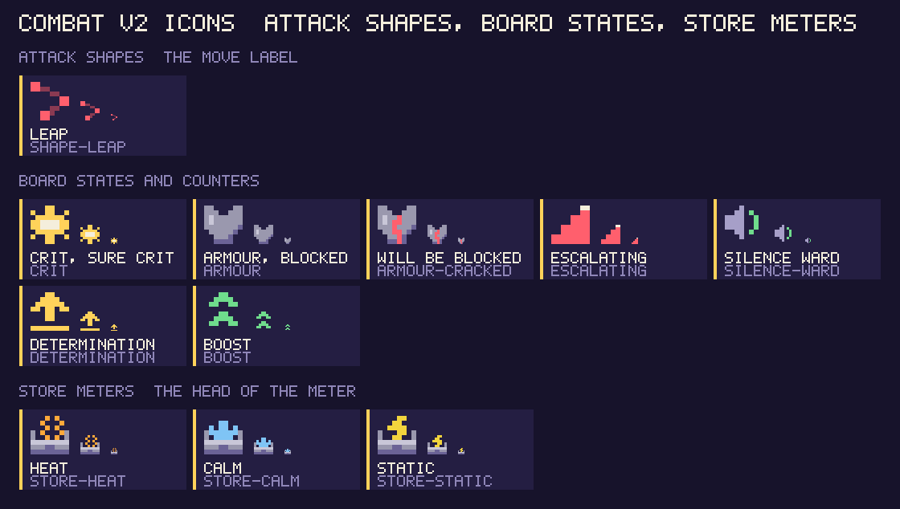

- **Status:** draft
- **Requested:** 2026-10-31, Misa: "icons for keywords and attack shapes" (roadmap phase 3, combat v2).
- **Source:** `apps/activity/src/sprites/concepts/combat-icons.ts` (draw it with `pnpm art combat-icons`)
- **Sheet of:** `4312f4866bc3`
- The audit is docs/design/combat/icons.md: which icons are new, which shipped glyphs are used as they are, and which words stay text.
- Misa's review, 2026-11-01. Liked as drawn: Quake, Cross, Checker, One-shot ("really like"), Barrage ("three marks is enough"), Sweep, Crit. Redrawn in round 2 (each replaces the shipped glyph for combat v2, which v1 keeps using): Slam, Strike, Lance, Pincer, Leap, Plain attack, Boost, and the three Store meters.
- Round 2 feedback: Slam "the target, then the adjacent creatures: like the cross, but the centre square bigger, one square left and right". Strike "the right shape, but inside a circle: remove the circle". Lance "should point downwards: the boss attacks from top to bottom". Pincer "a very subtle crab-pincer; the white dot is unnecessary" (both options shown). Leap "like Barrage, but squares, with a faint line between them, a zigzag". Plain attack "should look different from a move: something like a sword". Boost "a star does not look good". Store meters "a box, chest, safe, vault or basket that contains something: one container for all, each holding its own thing; the amount as text beside it (x3), never in the icon".
- Round 2 answers (Misa, 2026-11-01): liked as drawn: Slam, Strike ("different from Cross, good enough"), Lance, Pincer (claws: "looking pretty good"; the plain alternative is removed), the plain attack sword, the three Stores ("nice"). Leap: "it looks like a fork right now; move the bottom square right a pixel or two, so it reads as a chain": done in round 3, awaiting his look. Still draft (not commented on): Boost, Escalating, armour, cracked armour, silence ward, Determination.
- Moved into `glyphs.ts` (2026-11-03, the v2 raid tab used them first): Quake, Cross, Checker, One-shot, Slam, Strike, Lance, Pincer and the plain attack, under the ids they had here. They stand in the sheet as shipped glyphs now. Leap and the six unreviewed ones stay here: a screen draws their drafts (`combat-glyphs.ts`) until Misa answers, then they move too.
- Needs before use: Misa approves the look; each icon gets a glyph id in glyphs.ts, a glossary entry and (shapes) a place in moveLabel; the dungeon modifier "extra crits" then switches from the reticle to the Crit icon.
- Cut order if Misa wants fewer icons: the three Store meter heads (name the resource in text), then the silence ward, then the cracked armour (a crack drawn over the armour icon), then One-shot (it shares the Strike crosshairs).

| Code | Kind | Role | Status | Idea |
| --- | --- | --- | --- | --- |
| `shape-leap` | glyph | Leap | draft | Leap (was Leaping Strike; redrawn, round 3): the strongest, then the next, softer. Like Barrage but three squares, joined by a faint zigzag line (a bolt, without the bolt that Spark already is). Misa, 2026-11-01: "it looks like a fork right now; move the bottom square right a pixel or two, so it reads as a chain". The bottom square moved 2 pixels right (1 pixel still read as a ">" arrow); the line still joins it. |
| `crit` | glyph | Crit, Sure Crit | liked | A lucky hit that deals double. A gold burst; a Sure Crit counter is this burst with its count ("x2"), never a meter of its own. |
| `armour` | glyph | Armour, Blocked | draft | Armour on the boss card (with its number) and the shield of a Blocked hit (with 0). A steel breastplate, so it is not the Guard's shield. |
| `armour-cracked` | glyph | Will be Blocked | draft | On a creature whose plain hit would be Blocked by the boss's armour: the breastplate with a red crack through it. |
| `escalating` | glyph | Escalating | draft | The boss grows as the weekend goes on, a step at a time. Rising steps, the top one lit. |
| `silence-ward` | glyph | Silence ward | draft | A warded creature cannot be silenced. The Silenced speaker with sound waves instead of a cross. |
| `determination` | glyph | Determination | draft | More damage and healing for each failed weekend on the same boss. A gold arrow rising from a base: more each failed try, up to five. |
| `boost` | glyph | Boost | draft | A Support's bonus on a creature's next hit (round 2): two upward chevrons, a rank going up. No star, and no filled arrow with a base, so it is not Determination's rising arrow. |
| `store-heat` | glyph | Heat | liked | The Heat store (Boiling Point): the shared box with heat rising from it in waves. The count is text beside it ("x3"). Misa, 2026-11-01: "nice". |
| `store-calm` | glyph | Calm | liked | The Calm store (Eye of the Storm): the shared box with a lotus in it. The count is text beside it ("x2"). Misa, 2026-11-01: "nice". |
| `store-static` | glyph | Static | liked | The Static store (a dodge fills it): the shared box with a small crackle in it. The count is text beside it ("x1"). Misa, 2026-11-01: "nice". |

## House: the Cosy starter set

- **Status:** draft
- **Requested:** 2026-11-09: player housing, art batch E4: the starter set mapped from the living room and its three new pieces.
- **Source:** `apps/activity/src/sprites/concepts/house-cosy.ts` (draw it with `pnpm art house-cosy`)
- **Sheet of:** `c89576d01012`
- Fifteen of the eighteen pieces are the living room props (`data/room-sprites.ts`) shared, not copied; the sofa, pouf and beanbag stack their back and front prop into one piece plus a front layer.
- New: bed, cupboard, wall shelf, and the cut-apart wallpaper and floor.
- The backdrop is the starter wallpaper; the night row of each piece is the room at night.
- A front layer has the same size and origin as its piece. The content (package D) and the scene (C1) need the housing content before this art is used.

| Code | Kind | Role | Status | Idea |
| --- | --- | --- | --- | --- |
| `cosy-sofa` | free |  | draft | The living room couch: coral with cream cushions and gold buttons, two room props stacked (back and seat front); the front layer is the arms and seat front. |
| `cosy-sofa-front` | free |  | draft | The front layer of cosy-sofa: drawn over the creature that sits or sleeps on it, same size and origin as the piece. |
| `cosy-table` | free |  | draft | The room table with a teal cloth and a cream runner; the living room prop with its legs given feet. |
| `cosy-chair` | free |  | draft | The room chair: a wicker back in warm wood. |
| `cosy-stool` | free |  | draft | The room stool: a coral cushion on a wooden frame. |
| `cosy-lamp` | free |  | draft | The hanging lamp: a cream shade on a cord, it glows at night. |
| `cosy-lamp-glow` | free |  | draft | The glow of cosy-lamp at night, drawn behind it. |
| `cosy-plant` | free |  | draft | The room plant: leaves in a clay pot. |
| `cosy-hearth` | free |  | draft | The fireplace: a stone chimney breast with the fire lit, its night glow behind. |
| `cosy-hearth-glow` | free |  | draft | The glow of cosy-hearth at night, drawn behind it. |
| `cosy-rug` | free |  | draft | The room rug: teal with a cream border. |
| `cosy-seat` | free |  | draft | The teal pouf; the front layer is the rim in front of whoever sits on it. |
| `cosy-seat-front` | free |  | draft | The front layer of cosy-seat: drawn over the creature that sits or sleeps on it, same size and origin as the piece. |
| `cosy-beanbag` | free |  | draft | The violet beanbag with gold stitching; the front layer is the slumped front. |
| `cosy-beanbag-front` | free |  | draft | The front layer of cosy-beanbag: drawn over the creature that sits or sleeps on it, same size and origin as the piece. |
| `cosy-cushion` | free |  | draft | The floor cushion with a gold tassel. |
| `cosy-shelf` | free |  | draft | The room bookshelf, form cupboard: three shelves of coloured books. |
| `cosy-clock` | free |  | draft | The wall clock. |
| `cosy-frame` | free |  | draft | The picture frame: a green hill under a blue sky. |
| `cosy-curtains` | free |  | draft | The window with its drapes and sill; the night row is the room window at night (its own rows). |
| `cosy-bed` | free |  | draft | NEW. A wooden bed with a coral quilt: a tall headboard, a low footboard, a pillow. The front layer is the quilt, over a creature asleep at the pillow (sleep anchor x 10, y 1). |
| `cosy-bed-front` | free |  | draft | The front layer of cosy-bed: drawn over the creature that sits or sleeps on it, same size and origin as the piece. |
| `cosy-cupboard` | free |  | draft | NEW. A wooden cupboard with two panelled doors, a hanging pair of gold knobs, a coral heart on each door and a drawer. |
| `cosy-shelf-wall` | free |  | draft | NEW. A wall shelf on two brackets with leaning books, a cream mug and a small plant. |
| `cosy-wall` | free |  | draft | The starter wallpaper, 16x52, repeats across: the living room wall cut down to its trim, stripes and wainscot. |
| `cosy-floor` | free |  | draft | The starter floor, 16x8: two rows of the living room planks. |

## House: garden and pool pieces

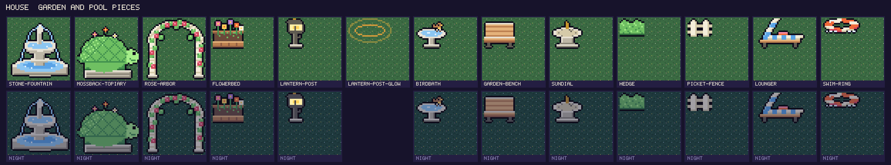

- **Status:** draft
- **Requested:** 2026-11-09: player housing, art batch E4: twelve garden and pool pieces that sit on grass and by water and read from a distance.
- **Source:** `apps/activity/src/sprites/concepts/house-garden.ts` (draw it with `pnpm art house-garden`)
- **Sheet of:** `bbeaa6d956e3`
- Drawn for the valley grass (the sheet stands them on the world map grass tile, night on the night tile). Stone is pale and the leaves are lighter than the grass so they read against it.
- The hedge and picket fence are repeating segments; their side edges are open so neighbours join.
- The lantern post has a glow sprite for night. The night row keeps the lantern lit.
- The content (package D) needs the housing content before this art is used; the ids are the names in kebab case.

| Code | Kind | Role | Status | Idea |
| --- | --- | --- | --- | --- |
| `stone-fountain` | free |  | draft | A two-tier stone fountain: a wide basin, a pedestal, an upper bowl and a finial, with water falling in thin lines. |
| `mossback-topiary` | free |  | draft | A hedge clipped into a Mossback: a leafy shell with scutes cut in, a head, four stubby legs, three flowers growing on its back, in a stone tub. Blueprint from Verdant Hollow. |
| `rose-arbor` | free |  | draft | A white trellis arch on two posts, pink and red roses climbing it; open in the middle so a path runs under. |
| `flowerbed` | free |  | draft | A log-edged bed with five flowers (pink, gold, violet, orange, cream). Starter blueprint. |
| `lantern-post` | free |  | draft | An iron post with a lit lantern and a scroll bracket; its glow is a pool of light on the ground. Blueprint from the Festival Grounds. |
| `lantern-post-glow` | free |  | draft | The glow of lantern-post at night, drawn behind it. |
| `birdbath` | free |  | draft | A pedestal bird bath with water in the bowl and a small blue bird on the rim. |
| `garden-bench` | free |  | draft | A wooden slat bench with iron legs and arms. |
| `sundial` | free |  | draft | A round stone plinth with a pale dial plate, hour ticks and a brass gnomon. |
| `hedge` | free |  | draft | A hedge segment, 16x12, with a lumpy top; the left and right edges are open so segments join. Starter blueprint. |
| `picket-fence` | free |  | draft | A white picket fence segment, 16x12: two pointed pickets on two rails, open at both edges so segments join. |
| `lounger` | free |  | draft | A pool lounger: a raised back and seat in blue and white stripes on a wooden frame, a coral towel folded on it. |
| `swim-ring` | free |  | draft | A red and white swim ring floating on a ripple, seen from slightly above. Blueprint from Tidepools. |

## House: the wild pieces

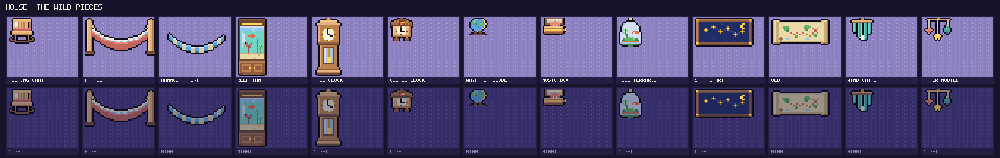

- **Status:** draft
- **Requested:** 2026-11-09: player housing, art batch E4: twelve one-off pieces that belong to no set, each with character.
- **Source:** `apps/activity/src/sprites/concepts/house-wild.ts` (draw it with `pnpm art house-wild`)
- **Sheet of:** `240003441bf5`
- Twelve pieces, one palette for the pack. Each is a different form (chair, bed, tall, clock, stool, plant, shelf, hanging) so it fits its spot box (`docs/design/housing.md`, 2.5).
- The hammock is a bed: it has a sleep anchor and a front layer.
- The night row is a plain dusk recolour (the house colours its pieces by phase itself).
- The content (package D) needs the housing content before this art is used; the ids are the names in kebab case.

| Code | Kind | Role | Status | Idea |
| --- | --- | --- | --- | --- |
| `rocking-chair` | free |  | draft | A spindle-backed rocking chair with long curved runners, a coral cushion and a cream blanket over the back. Starter blueprint. |
| `hammock` | free |  | draft | A sea-blue striped hammock slung between two posts with brass hooks; the near side of the cloth is the front layer, so a creature lies inside it (sleep anchor x 16, y 6). Blueprint from the Tidepools. |
| `hammock-front` | free |  | draft | The front layer of hammock: drawn over the creature that sits or sleeps on it, same size and origin as the piece. |
| `reef-tank` | free |  | draft | A tall aquarium on a wooden cabinet: a light bar, coral, weed, an orange fish and bubbles in teal water. Blueprint from Moonlit Reef. |
| `tall-clock` | free |  | draft | A grandfather clock: pediment and finial, a round cream face, a glass door with a brass pendulum. Blueprint from a cleared raid finale. |
| `cuckoo-clock` | free |  | draft | A chalet clock with shingled roof, a round face, a small bird calling from its door, and two pinecone weights on chains. Blueprint from the dungeon. |
| `wayfarer-globe` | free |  | draft | A blue globe with green lands in a brass meridian on a tripod. Feat: the Wayfarer stamp. |
| `music-box` | free |  | draft | A wooden music box with a gold inlay band, its lid open on a dancer in a pink tutu, and a brass crank. Blueprint from a Games gold. |
| `moss-terrarium` | free |  | draft | A glass dome on a wooden base holding moss, a fern and a red mushroom. Blueprint from Verdant Hollow. |
| `star-chart` | free |  | draft | A framed night sky: navy ground, a gold constellation joined by lines, a crescent moon, brass corners. Blueprint from Storm Ridge. |
| `old-map` | free |  | draft | A parchment map between two rolled ends, with green islands, a dashed route and a red cross. Blueprint from the Old Crossroads. |
| `wind-chime` | free |  | draft | Four teal tubes hang from a wooden ring on a brass hook, with a cream sail below the striker. Blueprint from Storm Ridge. |
| `paper-mobile` | free |  | draft | A bar with three strings: a coral paper crane, a gold star and a teal lantern. Blueprint from the Festival Grounds. |

## House: stamps, displays, materials and glyphs

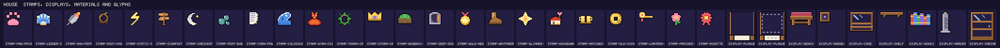

- **Status:** draft
- **Requested:** 2026-11-09: housing art batch E5 (docs/design/housing.md, section 5): 24 stamps, the hall displays, 16 luxury materials, the House glyphs.
- **Source:** `apps/activity/src/sprites/concepts/house-marks.ts` (draw it with `pnpm art house-marks`)
- **Sheet of:** `89e4aa5ce8a3`
- Stamps are 16x16 with the ink outline; displays follow the plan (plaque 28x32). Materials differ by shape: woods are timber, stones gems, metals ingots and ore, cloth folded or rolled.
- Used by the House (housing flag); nothing ships until the pack is imported by house-art.ts.

| Code | Kind | Role | Status | Idea |
| --- | --- | --- | --- | --- |
| `stamp-paw-print` | free |  | draft | The starter stamp: a pink paw, four toes and a pad. |
| `stamp-ledger-shell` | free |  | draft | The Tide Ledger: a scallop shell with blue ridges. |
| `stamp-ash-feather` | free |  | draft | The Ash Records: a grey quill dipped in ember. |
| `stamp-root-knot` | free |  | draft | Rootwork Notes: a root tied in a loop, a bud on top. |
| `stamp-static-spark` | free |  | draft | Static Letters: a lightning bolt. |
| `stamp-signpost` | free |  | draft | The Signpost Series: a post with two boards. |
| `stamp-crescent` | free |  | draft | Moonlit Verses: a crescent moon and a star. |
| `stamp-peat-bubble` | free |  | draft | The Peat Notes: three bubbles rising from the bog. |
| `stamp-torn-page` | free |  | draft | Lost Pages: a page with a ragged edge. |
| `stamp-colossus-wave` | free |  | draft | Tidal Colossus beaten: a wave curling over. |
| `stamp-wyrm-coil` | free |  | draft | Cinder Wyrm beaten: a coiled serpent with horns. |
| `stamp-thorn-crown` | free |  | draft | Thornmother beaten: a wreath of thorned vine. |
| `stamp-storm-crown` | free |  | draft | Storm Sovereign beaten: a gold crown with a storm gem. |
| `stamp-bogback-moss` | free |  | draft | Old Bogback beaten: a mossy shell. |
| `stamp-deep-door` | free |  | draft | Dungeon depth 10: an arched door on the dark. |
| `stamp-gold-medal` | free |  | draft | A Games gold: a medal on its ribbon. |
| `stamp-wayfarer` | free |  | draft | Seven places visited: a walking boot. |
| `stamp-glimmer-star` | free |  | draft | A shiny found: a four point sparkle. |
| `stamp-housewarming` | free |  | draft | The cottage built: a house with a heart of smoke. |
| `stamp-matched-set` | free |  | draft | One set finished: two matching cups. |
| `stamp-old-coin` | free |  | draft | Rare raid drop: a worn coin with a square hole. |
| `stamp-lantern-key` | free |  | draft | Rare dungeon drop: a key with a lantern for a bow. |
| `stamp-pressed-flower` | free |  | draft | Rare trip drop: a flower pressed flat. |
| `stamp-rosette` | free |  | draft | Rare Games drop: a pleated rosette with ribbon tails. |
| `display-plaque` | free |  | draft | Raid plaque, 28x32: a wooden board with a dark window for the 24x24 boss sprite (drawn at x 2, y 1) and a cream plate for the 3-digit rank (x 6..21, y 26..30). |
| `display-plaque-empty` | free |  | draft | The same board, empty: a dashed outline where the boss would hang, three dashes for the rank. |
| `display-bench` | free |  | draft | Games medals: a cushioned bench the medals lie on. |
| `display-badge-slot` | free |  | draft | Games badges: a small framed velvet square with a pin hole. |
| `display-case` | free |  | draft | Festival trophies: a glass case with a shelf. |
| `display-shelf` | free |  | draft | Keepsakes: a wall shelf on two brackets; the 12x12 keepsakes stand on it. |
| `display-books` | free |  | draft | Journal: a row of spines. |
| `display-marker` | free |  | draft | Dungeon depth: a standing stone with tally marks and a small light. |
| `display-cabinet` | free |  | draft | Set keepsakes: a glass-fronted cabinet with three shelves. |

## House set: Emberhold

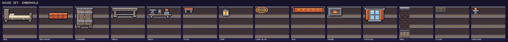

- **Status:** draft
- **Requested:** 2026-11-09: player housing, furniture set art (batch E2).
- **Source:** `apps/activity/src/sprites/concepts/house-emberhold.ts` (draw it with `pnpm art house-emberhold`)
- **Sheet of:** `6118c6b6715e`
- Used by the housing feature (docs/design/housing.md): piece ids are <set>-<form>, skin ids <set>-wall and <set>-floor.
- Square black charwood with riveted iron bands and an amber glow.

| Code | Kind | Role | Status | Idea |
| --- | --- | --- | --- | --- |
| `bed` | free |  | draft | Bed, 48x26: a sleep anchor; the blanket is its own front layer. Square black charwood with riveted iron bands and an amber glow. |
| `bed-front` | free |  | draft | The bed’s blanket, drawn over the sleeping housemate. |
| `cupboard` | free |  | draft | Cupboard, 30x36, floor-large. Square black charwood with riveted iron bands and an amber glow. |
| `table` | free |  | draft | Table, 44x18, floor-large. Square black charwood with riveted iron bands and an amber glow. |
| `shelf` | free |  | draft | Wall shelf, 40x20, wall-large, with a few things on it. Square black charwood with riveted iron bands and an amber glow. |
| `stool` | free |  | draft | Stool, 16x12, floor-small. Square black charwood with riveted iron bands and an amber glow. |
| `lamp` | free |  | draft | Ceiling lamp, 20x16, hangs from the top row; it has a night glow. Square black charwood with riveted iron bands and an amber glow. |
| `lamp-glow` | free |  | draft | The lamp’s glow at night, drawn under the lamp. |
| `rug` | free |  | draft | Rug, 56x10, lies on the floor line. Square black charwood with riveted iron bands and an amber glow. |
| `frame` | free |  | draft | Picture frame, 24x16, wall-small. Square black charwood with riveted iron bands and an amber glow. |
| `curtains` | free |  | draft | Window with its dressing, 36x26, window spot. Square black charwood with riveted iron bands and an amber glow. |
| `wall` | free |  | draft | Wallpaper tile 16x52, repeats across the room. |
| `floor` | free |  | draft | Floor tile 16x8, repeats across the room. |
| `keepsake` | free |  | draft | The keepsake in the cabinet when the set is complete, 12x12. |

## House set: Moonlit

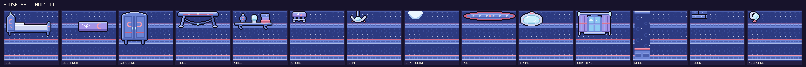

- **Status:** draft
- **Requested:** 2026-11-09: player housing, furniture set art (batch E2).
- **Source:** `apps/activity/src/sprites/concepts/house-moonlit.ts` (draw it with `pnpm art house-moonlit`)
- **Sheet of:** `a49e699edf2a`
- Used by the housing feature (docs/design/housing.md): piece ids are <set>-<form>, skin ids <set>-wall and <set>-floor.
- Slim night-reef lacquer with a crescent inlay, coral pink trim, a moonstone knob and silver rims.

| Code | Kind | Role | Status | Idea |
| --- | --- | --- | --- | --- |
| `bed` | free |  | draft | Bed, 48x26: a sleep anchor; the blanket is its own front layer. Slim night-reef lacquer with a crescent inlay, coral pink trim, a moonstone knob and silver rims. |
| `bed-front` | free |  | draft | The bed’s blanket, drawn over the sleeping housemate. |
| `cupboard` | free |  | draft | Cupboard, 30x36, floor-large. Slim night-reef lacquer with a crescent inlay, coral pink trim, a moonstone knob and silver rims. |
| `table` | free |  | draft | Table, 44x18, floor-large. Slim night-reef lacquer with a crescent inlay, coral pink trim, a moonstone knob and silver rims. |
| `shelf` | free |  | draft | Wall shelf, 40x20, wall-large, with a few things on it. Slim night-reef lacquer with a crescent inlay, coral pink trim, a moonstone knob and silver rims. |
| `stool` | free |  | draft | Stool, 16x12, floor-small. Slim night-reef lacquer with a crescent inlay, coral pink trim, a moonstone knob and silver rims. |
| `lamp` | free |  | draft | Ceiling lamp, 20x16, hangs from the top row; it has a night glow. Slim night-reef lacquer with a crescent inlay, coral pink trim, a moonstone knob and silver rims. |
| `lamp-glow` | free |  | draft | The lamp’s glow at night, drawn under the lamp. |
| `rug` | free |  | draft | Rug, 56x10, lies on the floor line. Slim night-reef lacquer with a crescent inlay, coral pink trim, a moonstone knob and silver rims. |
| `frame` | free |  | draft | Picture frame, 24x16, wall-small. Slim night-reef lacquer with a crescent inlay, coral pink trim, a moonstone knob and silver rims. |
| `curtains` | free |  | draft | Window with its dressing, 36x26, window spot. Slim night-reef lacquer with a crescent inlay, coral pink trim, a moonstone knob and silver rims. |
| `wall` | free |  | draft | Wallpaper tile 16x52, repeats across the room. |
| `floor` | free |  | draft | Floor tile 16x8, repeats across the room. |
| `keepsake` | free |  | draft | The keepsake in the cabinet when the set is complete, 12x12. |

## House set: Rootwood

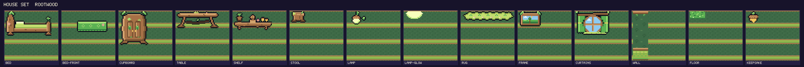

- **Status:** draft
- **Requested:** 2026-11-09: player housing, furniture set art (batch E2).
- **Source:** `apps/activity/src/sprites/concepts/house-rootwood.ts` (draw it with `pnpm art house-rootwood`)
- **Sheet of:** `f97a5a14df8c`
- Used by the housing feature (docs/design/housing.md): piece ids are <set>-<form>, skin ids <set>-wall and <set>-floor.
- Living-wood curves with a leaf curl at the top corners and moss cushions.

| Code | Kind | Role | Status | Idea |
| --- | --- | --- | --- | --- |
| `bed` | free |  | draft | Bed, 48x26: a sleep anchor; the blanket is its own front layer. Living-wood curves with a leaf curl at the top corners and moss cushions. |
| `bed-front` | free |  | draft | The bed’s blanket, drawn over the sleeping housemate. |
| `cupboard` | free |  | draft | Cupboard, 30x36, floor-large. Living-wood curves with a leaf curl at the top corners and moss cushions. |
| `table` | free |  | draft | Table, 44x18, floor-large. Living-wood curves with a leaf curl at the top corners and moss cushions. |
| `shelf` | free |  | draft | Wall shelf, 40x20, wall-large, with a few things on it. Living-wood curves with a leaf curl at the top corners and moss cushions. |
| `stool` | free |  | draft | Stool, 16x12, floor-small. Living-wood curves with a leaf curl at the top corners and moss cushions. |
| `lamp` | free |  | draft | Ceiling lamp, 20x16, hangs from the top row; it has a night glow. Living-wood curves with a leaf curl at the top corners and moss cushions. |
| `lamp-glow` | free |  | draft | The lamp’s glow at night, drawn under the lamp. |
| `rug` | free |  | draft | Rug, 56x10, lies on the floor line. Living-wood curves with a leaf curl at the top corners and moss cushions. |
| `frame` | free |  | draft | Picture frame, 24x16, wall-small. Living-wood curves with a leaf curl at the top corners and moss cushions. |
| `curtains` | free |  | draft | Window with its dressing, 36x26, window spot. Living-wood curves with a leaf curl at the top corners and moss cushions. |
| `wall` | free |  | draft | Wallpaper tile 16x52, repeats across the room. |
| `floor` | free |  | draft | Floor tile 16x8, repeats across the room. |
| `keepsake` | free |  | draft | The keepsake in the cabinet when the set is complete, 12x12. |

## House set: Tidepool

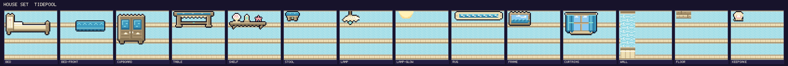

- **Status:** draft
- **Requested:** 2026-11-09: player housing, furniture set art (batch E2).
- **Source:** `apps/activity/src/sprites/concepts/house-tidepool.ts` (draw it with `pnpm art house-tidepool`)
- **Sheet of:** `749215950665`
- Used by the housing feature (docs/design/housing.md): piece ids are <set>-<form>, skin ids <set>-wall and <set>-floor.
- Driftwood with scalloped shell edges; sea blue, sand, pearl white.

| Code | Kind | Role | Status | Idea |
| --- | --- | --- | --- | --- |
| `bed` | free |  | draft | Bed, 48x26: a sleep anchor; the blanket is its own front layer. Driftwood with scalloped shell edges; sea blue, sand, pearl white. |
| `bed-front` | free |  | draft | The bed’s blanket, drawn over the sleeping housemate. |
| `cupboard` | free |  | draft | Cupboard, 30x36, floor-large. Driftwood with scalloped shell edges; sea blue, sand, pearl white. |
| `table` | free |  | draft | Table, 44x18, floor-large. Driftwood with scalloped shell edges; sea blue, sand, pearl white. |
| `shelf` | free |  | draft | Wall shelf, 40x20, wall-large, with a few things on it. Driftwood with scalloped shell edges; sea blue, sand, pearl white. |
| `stool` | free |  | draft | Stool, 16x12, floor-small. Driftwood with scalloped shell edges; sea blue, sand, pearl white. |
| `lamp` | free |  | draft | Ceiling lamp, 20x16, hangs from the top row; it has a night glow. Driftwood with scalloped shell edges; sea blue, sand, pearl white. |
| `lamp-glow` | free |  | draft | The lamp’s glow at night, drawn under the lamp. |
| `rug` | free |  | draft | Rug, 56x10, lies on the floor line. Driftwood with scalloped shell edges; sea blue, sand, pearl white. |
| `frame` | free |  | draft | Picture frame, 24x16, wall-small. Driftwood with scalloped shell edges; sea blue, sand, pearl white. |
| `curtains` | free |  | draft | Window with its dressing, 36x26, window spot. Driftwood with scalloped shell edges; sea blue, sand, pearl white. |
| `wall` | free |  | draft | Wallpaper tile 16x52, repeats across the room. |
| `floor` | free |  | draft | Floor tile 16x8, repeats across the room. |
| `keepsake` | free |  | draft | The keepsake in the cabinet when the set is complete, 12x12. |

## House: Ancient set

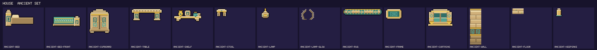

- **Status:** draft
- **Requested:** 2026-11-09: player housing furniture, batch E3 (Stormglass, Fenkeeper, Ancient, Lantern Night), see docs/design/housing.md section 5.
- **Source:** `apps/activity/src/sprites/concepts/house-ancient.ts` (draw it with `pnpm art house-ancient`)
- **Sheet of:** `eeaa6bc84a68`
- Neutral set: sandstone, faded gold, patina teal; stepped ziggurat tops, thick square legs, spirals carved in every piece.
- Needs the housing content (piece, skin and set ids as drawn); the pack goes to data/house/ancient.ts and is read by house-art.ts.

| Code | Kind | Role | Status | Idea |
| --- | --- | --- | --- | --- |
| `ancient-bed` | free |  | draft | bed, 48x26, floor-large: headboard, mattress, pillow; the blanket is the front layer over the sleeper |
| `ancient-bed-front` | free |  | draft | bed: the layer drawn over the sleeper |
| `ancient-cupboard` | free |  | draft | cupboard, 30x36, floor-large: two doors, a plinth |
| `ancient-table` | free |  | draft | table, 44x18, floor-large: a top on legs |
| `ancient-shelf` | free |  | draft | wall shelf, 40x20, wall-large: a board on brackets with a few things on it |
| `ancient-stool` | free |  | draft | stool, 16x12, floor-small |
| `ancient-lamp` | free |  | draft | hanging lamp, 20x16, ceiling: hangs from the top row; the glow sprite is drawn over it at night |
| `ancient-lamp-glow` | free |  | draft | lamp: night glow, drawn over the lamp |
| `ancient-rug` | free |  | draft | rug, 56x10, rug spot: flat, seen from the front |
| `ancient-frame` | free |  | draft | picture frame, 24x16, wall-small |
| `ancient-curtains` | free |  | draft | window with its dressing, 36x26, window spot |
| `ancient-wall` | free |  | draft | wallpaper tile 16x52, repeats across, no outline |
| `ancient-floor` | free |  | draft | floor tile 16x8, repeats across, no outline |
| `ancient-keepsake` | free |  | draft | keepsake 12x12, shown in the trophy hall cabinet when the set is complete |

## House: Fenkeeper set

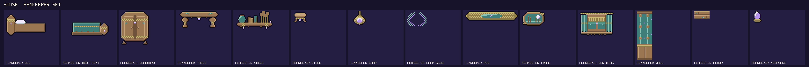

- **Status:** draft
- **Requested:** 2026-11-09: player housing furniture, batch E3 (Stormglass, Fenkeeper, Ancient, Lantern Night), see docs/design/housing.md section 5.
- **Source:** `apps/activity/src/sprites/concepts/house-fenkeeper.ts` (draw it with `pnpm art house-fenkeeper`)
- **Sheet of:** `ae8fb8587e6c`
- Mire set: dark bog oak, reed binding, murky teal and an opal drop; squat, round, bulb legs, uneven drips.
- Needs the housing content (piece, skin and set ids as drawn); the pack goes to data/house/fenkeeper.ts and is read by house-art.ts.

| Code | Kind | Role | Status | Idea |
| --- | --- | --- | --- | --- |
| `fenkeeper-bed` | free |  | draft | bed, 48x26, floor-large: headboard, mattress, pillow; the blanket is the front layer over the sleeper |
| `fenkeeper-bed-front` | free |  | draft | bed: the layer drawn over the sleeper |
| `fenkeeper-cupboard` | free |  | draft | cupboard, 30x36, floor-large: two doors, a plinth |
| `fenkeeper-table` | free |  | draft | table, 44x18, floor-large: a top on legs |
| `fenkeeper-shelf` | free |  | draft | wall shelf, 40x20, wall-large: a board on brackets with a few things on it |
| `fenkeeper-stool` | free |  | draft | stool, 16x12, floor-small |
| `fenkeeper-lamp` | free |  | draft | hanging lamp, 20x16, ceiling: hangs from the top row; the glow sprite is drawn over it at night |
| `fenkeeper-lamp-glow` | free |  | draft | lamp: night glow, drawn over the lamp |
| `fenkeeper-rug` | free |  | draft | rug, 56x10, rug spot: flat, seen from the front |
| `fenkeeper-frame` | free |  | draft | picture frame, 24x16, wall-small |
| `fenkeeper-curtains` | free |  | draft | window with its dressing, 36x26, window spot |
| `fenkeeper-wall` | free |  | draft | wallpaper tile 16x52, repeats across, no outline |
| `fenkeeper-floor` | free |  | draft | floor tile 16x8, repeats across, no outline |
| `fenkeeper-keepsake` | free |  | draft | keepsake 12x12, shown in the trophy hall cabinet when the set is complete |

## House: Lantern Night set

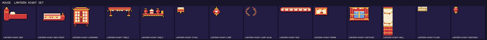

- **Status:** draft
- **Requested:** 2026-11-09: player housing furniture, batch E3 (Stormglass, Fenkeeper, Ancient, Lantern Night), see docs/design/housing.md section 5.
- **Source:** `apps/activity/src/sprites/concepts/house-lantern-night.ts` (draw it with `pnpm art house-lantern-night`)
- **Sheet of:** `e1ffb3f81605`
- Neutral set: festival red, gold, cream; round lantern shapes, bunting and tassels hanging from every piece.
- Needs the housing content (piece, skin and set ids as drawn); the pack goes to data/house/lantern-night.ts and is read by house-art.ts.

| Code | Kind | Role | Status | Idea |
| --- | --- | --- | --- | --- |
| `lantern-night-bed` | free |  | draft | bed, 48x26, floor-large: headboard, mattress, pillow; the blanket is the front layer over the sleeper |
| `lantern-night-bed-front` | free |  | draft | bed: the layer drawn over the sleeper |
| `lantern-night-cupboard` | free |  | draft | cupboard, 30x36, floor-large: two doors, a plinth |
| `lantern-night-table` | free |  | draft | table, 44x18, floor-large: a top on legs |
| `lantern-night-shelf` | free |  | draft | wall shelf, 40x20, wall-large: a board on brackets with a few things on it |
| `lantern-night-stool` | free |  | draft | stool, 16x12, floor-small |
| `lantern-night-lamp` | free |  | draft | hanging lamp, 20x16, ceiling: hangs from the top row; the glow sprite is drawn over it at night |
| `lantern-night-lamp-glow` | free |  | draft | lamp: night glow, drawn over the lamp |
| `lantern-night-rug` | free |  | draft | rug, 56x10, rug spot: flat, seen from the front |
| `lantern-night-frame` | free |  | draft | picture frame, 24x16, wall-small |
| `lantern-night-curtains` | free |  | draft | window with its dressing, 36x26, window spot |
| `lantern-night-wall` | free |  | draft | wallpaper tile 16x52, repeats across, no outline |
| `lantern-night-floor` | free |  | draft | floor tile 16x8, repeats across, no outline |
| `lantern-night-keepsake` | free |  | draft | keepsake 12x12, shown in the trophy hall cabinet when the set is complete |

## House: Stormglass set

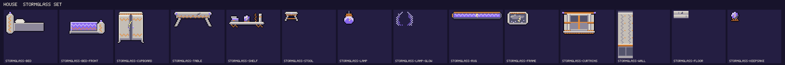

- **Status:** draft
- **Requested:** 2026-11-09: player housing furniture, batch E3 (Stormglass, Fenkeeper, Ancient, Lantern Night), see docs/design/housing.md section 5.
- **Source:** `apps/activity/src/sprites/concepts/house-stormglass.ts` (draw it with `pnpm art house-stormglass`)
- **Sheet of:** `51ba7eb297fe`
- Spark set: pale ash wood, slate, copper zigzag trim, storm-violet glass beads; angular, chamfered, splayed legs.
- Needs the housing content (piece, skin and set ids as drawn); the pack goes to data/house/stormglass.ts and is read by house-art.ts.

| Code | Kind | Role | Status | Idea |
| --- | --- | --- | --- | --- |
| `stormglass-bed` | free |  | draft | bed, 48x26, floor-large: headboard, mattress, pillow; the blanket is the front layer over the sleeper |
| `stormglass-bed-front` | free |  | draft | bed: the layer drawn over the sleeper |
| `stormglass-cupboard` | free |  | draft | cupboard, 30x36, floor-large: two doors, a plinth |
| `stormglass-table` | free |  | draft | table, 44x18, floor-large: a top on legs |
| `stormglass-shelf` | free |  | draft | wall shelf, 40x20, wall-large: a board on brackets with a few things on it |
| `stormglass-stool` | free |  | draft | stool, 16x12, floor-small |
| `stormglass-lamp` | free |  | draft | hanging lamp, 20x16, ceiling: hangs from the top row; the glow sprite is drawn over it at night |
| `stormglass-lamp-glow` | free |  | draft | lamp: night glow, drawn over the lamp |
| `stormglass-rug` | free |  | draft | rug, 56x10, rug spot: flat, seen from the front |
| `stormglass-frame` | free |  | draft | picture frame, 24x16, wall-small |
| `stormglass-curtains` | free |  | draft | window with its dressing, 36x26, window spot |
| `stormglass-wall` | free |  | draft | wallpaper tile 16x52, repeats across, no outline |
| `stormglass-floor` | free |  | draft | floor tile 16x8, repeats across, no outline |
| `stormglass-keepsake` | free |  | draft | keepsake 12x12, shown in the trophy hall cabinet when the set is complete |

## House shell (housing E1)

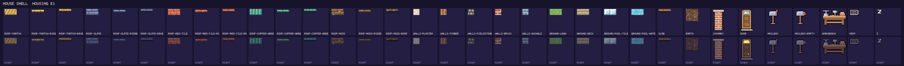

- **Status:** draft
- **Requested:** 2026-11-09: housing art batch E1, the building, roofs, walls and ground skins.
- **Source:** `apps/activity/src/sprites/concepts/house-shell.ts` (draw it with `pnpm art house-shell`)
- **Sheet of:** `e421550ed341`
- Pack: `src/sprites/data/house/shell.ts` (`HOUSE_ART`). Roof skins thatch, slate, red-tile, copper-green, moss; wall skins plaster, timber, fieldstone, brick, shingle; ground skins lawn, deck, pool-tile, pool-water.
- Skin colour keys are always L M D A B (light, mid, shade, accents); fixtures have their own keys.

| Code | Kind | Role | Status | Idea |
| --- | --- | --- | --- | --- |
| `roof-thatch` | free |  | draft | Thatch (starter): straw strands slanting down, a twine band, a bundled ridge. Tile 16 x 8. |
| `roof-thatch-ridge` | free |  | draft | Thatch (starter): straw strands slanting down, a twine band, a bundled ridge. The ridge cap, 16 x 4. |
| `roof-thatch-eave` | free |  | draft | Thatch (starter): straw strands slanting down, a twine band, a bundled ridge. The eave hem, 16 x 4. |
| `roof-slate` | free |  | draft | Slate: square plates, cool blue-grey. Tile 16 x 8. |
| `roof-slate-ridge` | free |  | draft | Slate: square plates, cool blue-grey. The ridge cap, 16 x 4. |
| `roof-slate-eave` | free |  | draft | Slate: square plates, cool blue-grey. The eave hem, 16 x 4. |
| `roof-red-tile` | free |  | draft | Red Tile: barrel tiles with scalloped bottoms, the valley house roof. Tile 16 x 8. |
| `roof-red-tile-ridge` | free |  | draft | Red Tile: barrel tiles with scalloped bottoms, the valley house roof. The ridge cap, 16 x 4. |
| `roof-red-tile-eave` | free |  | draft | Red Tile: barrel tiles with scalloped bottoms, the valley house roof. The eave hem, 16 x 4. |
| `roof-copper-green` | free |  | draft | Copper Green: standing seams with copper rivets. Tile 16 x 8. |
| `roof-copper-green-ridge` | free |  | draft | Copper Green: standing seams with copper rivets. The ridge cap, 16 x 4. |
| `roof-copper-green-eave` | free |  | draft | Copper Green: standing seams with copper rivets. The eave hem, 16 x 4. |
| `roof-moss` | free |  | draft | Moss: brown shingles with moss creeping along the seams. Tile 16 x 8. |
| `roof-moss-ridge` | free |  | draft | Moss: brown shingles with moss creeping along the seams. The ridge cap, 16 x 4. |
| `roof-moss-eave` | free |  | draft | Moss: brown shingles with moss creeping along the seams. The eave hem, 16 x 4. |
| `walls-plaster` | free |  | draft | Plaster (starter): cream, speckled. Tile 8 x 8. |
| `walls-timber` | free |  | draft | Timber: upright boards, 4 px wide so a 4 px wall shows a whole board. Tile 8 x 8. |
| `walls-fieldstone` | free |  | draft | Fieldstone: uneven stones in dark mortar. Tile 8 x 8. |
| `walls-brick` | free |  | draft | Brick: running bond with light mortar. Tile 8 x 8. |
| `walls-shingle` | free |  | draft | Shingle: sea-blue wall shingles. Tile 8 x 8. |
| `ground-lawn` | free |  | draft | Lawn (garden default): grass, the lit top row is the ground line. Tile 16 x 8. |
| `ground-deck` | free |  | draft | Deck (terrace default): planks, top row lit. Tile 16 x 8. |
| `ground-pool-tile` | free |  | draft | Pool Tile: white tiles with grout, the basin wall and floor. Tile 16 x 8. |
| `ground-pool-water` | free |  | draft | Pool water: wraps sideways without a seam; the scene lays it inside the basin. Tile 16 x 8. |
| `slab` | free |  | draft | The floor slab between storeys, 16 x 4 (tiles sideways). |
| `earth` | free |  | draft | Earth around the cellar, 16 x 16 (tiles both ways). |
| `chimney` | free |  | draft | A brick chimney with a stone cap, 12 x 22; the scene sinks its foot into the roof. |
| `door` | free |  | draft | The front door with its step, 16 x 30, standing on the ground line. |
| `mailbox` | free |  | draft | The mailbox on its post, flag up, 12 x 18. |
| `workbench` | free |  | draft | The Hearth's workbench: a vise, a saw and a hammer. |
| `vent` | free |  | draft | The cellar vent window. |
| `z` | free |  | draft | The sleeping "z" over a housemate. |

## Element shards, told apart by shape

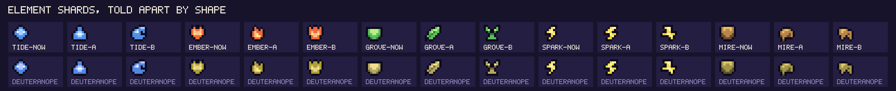

- **Status:** liked
- **Requested:** 2026-11-03: the element shard icons must differ by shape, not only colour (accessibility review from the valley session; Misa asked to provide what the valley needs).
- **Source:** `apps/activity/src/sprites/concepts/shards.ts` (draw it with `pnpm art shards`)
- **Sheet of:** `29260c21c2ac`
- Misa picked Tide A (rounded), Ember A, Grove A, Spark A, Mire B on 2026-11-03; now in gear-sprites.ts.
- Why: Ember (#ef6a3a) and Grove (#5cbf5a) are a classic deuteranope confusion pair and the shipped shards differ only in the top two rows. The Forge and Market loop is about which shard you need, so each element is a different outline. Colours are unchanged.
- Every sprite has a `deuteranope` alt (Machado 2009, severity 1.0). Its row in the set sheet is the test: five different shapes per variant column.
- Silhouettes: Tide a drop (a) or a curling wave (b); Ember a tall flame with a side tongue (a) or a crown of three flames (b); Grove a leaf on a stem (a) or a two-leaf sprout (b); Spark a bolt (a) or a zigzag (b); Mire a blob with one drip (a) or two drips (b).
- The picks replaced the sprites in `gear-sprites.ts` (BUNDLED_PART_ICONS keeps its ids); scrap and glimmer are untouched. The drafts stay here for reference.

| Code | Kind | Role | Status | Idea |
| --- | --- | --- | --- | --- |
| `tide-now` | part |  | draft | The shipped tide shard, unchanged, for comparison. |
| `tide-a` | part |  | liked | A drop: pointed top, round bottom with no square corners. |
| `tide-b` | part |  | draft | A wave crystal: a crest curling over to the right. |
| `ember-now` | part |  | draft | The shipped ember shard, unchanged, for comparison. |
| `ember-a` | part |  | liked | A tall flame: a main tongue with a smaller one at its side. |
| `ember-b` | part |  | draft | A crown of three flames on a short crystal. |
| `grove-now` | part |  | draft | The shipped grove shard, unchanged, for comparison. |
| `grove-a` | part |  | liked | A leaf, tilted, with a vein and a stem at its foot. |
| `grove-b` | part |  | draft | A sprout: two leaves on a stem, in a crystal base. |
| `spark-now` | part |  | draft | The shipped spark shard, unchanged, for comparison. |
| `spark-a` | part |  | liked | A fat bolt: a broad head stepping down to a thin tail. |
| `spark-b` | part |  | draft | A thin zigzag bolt, two sharp turns. |
| `mire-now` | part |  | draft | The shipped mire shard, unchanged, for comparison. |
| `mire-a` | part |  | draft | A lump with a single drip hanging from its belly. |
| `mire-b` | part |  | liked | A slumped blob with two drips, one longer. |

## The camp's other places, glow style

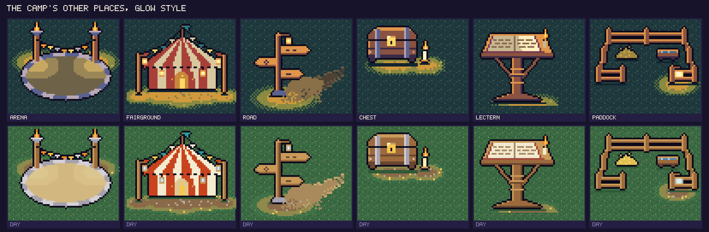

- **Status:** draft
- **Requested:** 2026-11-03: the valley prototype's remaining places (arena, fairground, road, chest, lectern, paddock) in the liked glow style, day and night.
- **Source:** `apps/activity/src/sprites/concepts/valley-glow-camp.ts` (draw it with `pnpm art valley-glow-camp`)
- **Sheet of:** `8a865da8a9b2`
- Extends the liked `valley-glow` set (same palette keys, ink, light rings and cast shadow) with the places the valley prototype draws in the camp clearing: `apps/activity/src/proto/party/` and `proto/valley/` on branch `origin/ccr-93a1de17-yutb1a`.
- The backdrop is the same as `valley-glow`: the world map grass tile in its night recolour, `alts.day` is the normal grass.
- By day the light rings become ground: worn dirt, trodden grass, pebbles and flowers. Fire (arena braziers) stays lit by day; lanterns and candles are unlit glass or plain wax. No text on any sign or page, only marks.

| Code | Kind | Role | Status | Idea |
| --- | --- | --- | --- | --- |
| `arena` | free |  | draft | A small sparring ring: a sand oval edged with grey stones, two posts at the back with a bunting between them and a brazier on each, whose warm light lies on the sand (brighter near the posts) and in stepped rings on the grass. The middle is left empty. By day the braziers stay lit, the sand is pale and the ground by the posts is worn dirt. |
| `fairground` | free |  | draft | A festive striped tent with a pennant on its pole, two strings of pennants running to side posts, four lanterns and a lit doorway with tied-back flaps. The lantern light lies on the grass in front. By day the lanterns are unlit glass and the ground in front is trodden straw and flowers. |
| `road` | free |  | draft | Where the road leaves the camp: a short worn dirt path that leaves the foot of the post and bends up to the right, fraying out into the grass (Misa, 2026-11-05: shorter, more to the right), and a wooden signpost with three plank arrows (marks, no words, each fully outlined) and a lantern on a hook. Warm light lies on the ground round the foot of the post. By day the lantern is unlit and the ground is a dirt patch with pebbles. |
| `chest` | free |  | draft | The shared camp chest: a banded wooden chest, lid closed (a lighter lid top and a dark seam), with a gold lock plate and a small glint, and a candle on the ground beside it. The candle light lies on the grass in stepped rings. By day the candle is unlit and the ground is trodden dirt. |
| `lectern` | free |  | draft | A reading stand: a slanted desk with an open journal (marks, no words) and a lit candle, on a single carved wooden post with a flared foot and two brackets under the desk. The candle lights the right-hand page and lays stepped rings on the grass. By day the candle is unlit and the ground is worn dirt. |
| `paddock` | free |  | draft | A fenced pen seen from the front-top: a straight back rail, short side rails, front rails with an open gate gap, a hay pile and a water trough at the back and a lantern on a front post. The inside is open grass for creatures. The lantern on the gate post lays stepped rings on the gate ground; by day it is unlit and the ground is trodden dirt. |

## Valley places: glow, day and night

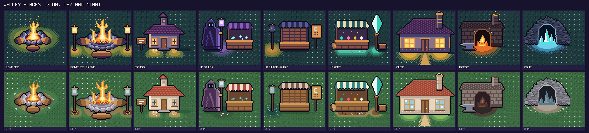

- **Status:** liked
- **Requested:** 2026-10-31: night glow redone to stand on the valley ground, with a daytime version of the same assets.
- **Source:** `apps/activity/src/sprites/concepts/valley-glow.ts` (draw it with `pnpm art valley-glow`)
- **Sheet of:** `1729e227b84b`
- Misa picked this direction for the valley places (2026-10-31); posters stay for each place's own screen.
- Direction "valley glow": the night-glow look (the light sources are the stars, lit edges, cool shadow) redone as standalone places on transparent ground, like the map landmarks, so they stand on the valley tiles. No sky, no vignette, no stars or moon.
- One drawing, two palettes: the main palette is night, `alts.day` recolours the same pixels. Keys `1 2 3` are the light spill on the ground (rings follow each light: a circle under a lamp or fire, a trapezoid in front of a window; only the outermost ring is a regular checker) in night colours; in the day palette they map to the grass greens, so the spill disappears. `x` is the cast shadow (cool blue at night, warm green by day).
- The backdrop is the world map grass tile (`WORLD_MAP_SPRITE_DATA.grass`): the main tile is its night recolour, `alts.day` is the normal grass. The sheet shows night on night grass and day on day grass.
- No creatures are drawn: logs, benches and the counters show where they would rest and stand; the game draws the real ones there.
- Each light has its own colour: fire orange (bonfires), window yellow (school), violet lamp (visitor), a weak ember (visitor away), teal shard glow (market).
- Day ground given its own character (Misa, 2026-10-31).
- Day ground pushed further and the market crystal seated (Misa, 2026-10-31).
- House, Forge and Cave added in the same style for the valley's night (valley session request, 2026-11-03).
- The content needs the places to exist (V-BON, school, visitor, V-FORGE-11) before this art is used; the signs carry no text, only marks (a moon and a calendar on the visitor away board).

| Code | Kind | Role | Status | Idea |
| --- | --- | --- | --- | --- |
| `bonfire` | free |  | liked | A fire in a ring of stones with three log seats around it; the logs and stones are lit on the fire side, and an orange glow lies on the grass around it. By day the same fire with no glow. |
| `bonfire-grand` | free |  | liked | The communal hearth at a later level: a tall fire with two side flames in a paved double ring, log benches, and two lantern posts that throw their own small light. The lamp glass has its own keys (G, H), so by day it is unlit glass while the fire stays lit. |
| `school` | free |  | liked | A small schoolhouse with a bell cupola, a sign by the path and two lit windows that spill yellow light on the grass in front. By day the windows are plain glass. |
| `visitor` | free |  | liked | The weekly visitor: a hooded stranger with teal eyes beside a violet lamp, and a small stall whose wares glow teal. The violet light lies on the grass; by day the lamp is unlit and the stall is striped red and cream. |
| `visitor-away` | free |  | liked | The stall shuttered: a closed front, a folded awning, a board with a moon and a calendar mark, an unlit lamp with one last ember and a faint warm glow on the grass. |
| `market` | free |  | liked | A stall where shards are traded: four element shards glow on the counter, a big shard on a post is the sign, with a crate and a sack beside it. The teal glow lies on the grass. |
| `house` | free |  | draft | A cosy cottage where your creatures live: a shingled roof with a chimney, two lit windows that spill warm light on the grass, a door with a path to it. By day the windows are plain glass and the spill is flower beds. |
| `forge` | free |  | draft | The Workshop: a stone smithy with an open fire mouth, an anvil on the ground and sparks; the ember glow spills out of the opening onto the ground. By day the fire stays alight, with sparks above the chimney and around the mouth; the yard is soot-dark. |
| `cave` | free |  | draft | The way to the daily dungeon: a rocky mouth into the hill with glowing crystals inside, whose cool light spills onto the ground. By day the crystals keep glowing and the ground is scree and pebbles. |

## Valley places: map landmarks

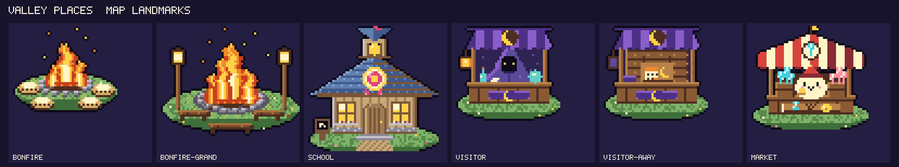

- **Status:** draft
- **Requested:** 2026-10-31: the bonfire, the School, the weekly visitor and the Market, in the direction of the expedition map art; try variations.
- **Source:** `apps/activity/src/sprites/concepts/valley-landmarks.ts` (draw it with `pnpm art valley-landmarks`)
- **Sheet of:** `7de1609620d1`
- One of several directions for the four valley places; this one draws each as a map marker. Compare it with the other sets before picking.
- To use: the valley screen composes places from sprites; these are free sprites up to 64 px and would be shown at their drawn size on grass.
- The visitor and visitor-away drawings share a stall; the away sign is a calendar page and a moon, not words.

| Code | Kind | Role | Status | Idea |
| --- | --- | --- | --- | --- |
| `bonfire` | free |  | draft | A crackling fire in a stone ring on a patch of grass, with four straw beds around it: 'room for four resting creatures'. |
| `bonfire-grand` | free |  | draft | The later level: a wider flagstone ring, a taller fire, log benches on three sides and two lantern posts. |
| `school` | free |  | draft | A little blue-roofed schoolhouse with a bell cupola and a graduation rosette on the gable; a slate stands by the door. |
| `visitor` | free |  | draft | A hooded stranger with glowing eyes behind a purple-awninged stall, a crescent moon on the awning and a lit lantern. |
| `visitor-away` | free |  | draft | The same stall shuttered, lantern out, a sign with a calendar page and a moon: 'back Thursday'. |
| `market` | free |  | draft | A red and cream striped tent stall where a tiny creature in a cap trades shards from two crates; sign shows shard and coin. |

## Valley places: night glow

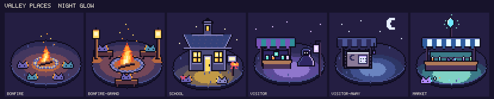

- **Status:** draft
- **Requested:** 2026-10-31: the bonfire, the School, the weekly visitor and the Market, in the direction of the expedition map art; try variations.
- **Source:** `apps/activity/src/sprites/concepts/valley-night.ts` (draw it with `pnpm art valley-night`)
- **Sheet of:** `56eb7da8b49a`
- Direction "night glow": each place at dusk or night, lit by its own light (fire orange, window yellow, violet lamp, teal shard glow), warm stepped rings on the ground and cool blue-purple shadow.
- Each sprite is a 64x64 island vignette (kind free, 16 colours) in a 3/4 top-down view, made to sit in a valley map; the island rim keeps it readable on the dark panels.
- The creatures in these are small stand-ins (10x7), not species; the game would draw the player's own creatures there.
- Names on the signs, the ribbon and the shard colours follow the designs on the valley branch; the content needs the places to exist (V-BON, school, visitor, V-FORGE-11) before this art is used.

| Code | Kind | Role | Status | Idea |
| --- | --- | --- | --- | --- |
| `bonfire` | free |  | draft | A fire in the middle of the valley with four resting creatures around it, each lit orange on the fire side and cool on the back: the warm heart, room for a rotating few. |
| `bonfire-grand` | free |  | draft | The communal hearth at a later level: a taller fire in a paved stone ring, log benches with three creatures, and two lantern posts that throw their own small light. |
| `school` | free |  | draft | A small schoolhouse with lit windows and a bell cupola; a creature outside wears the graduation ribbon, and a rosette hangs on the sign. |
| `visitor` | free |  | draft | The weekly visitor: a hooded stranger with violet lamp-light on one edge and two teal-white eyes, beside a small stall whose wares glow. |
| `visitor-away` | free |  | draft | The same stall shuttered: a "back Thursday" board with a moon and a calendar mark, an unlit lamp with one last spark, a pale moon above. |
| `market` | free |  | draft | A stall where a creature trades shards: four element shards glow on the counter, a big shard is the sign, and a customer waits with one. |

## Valley places: posters

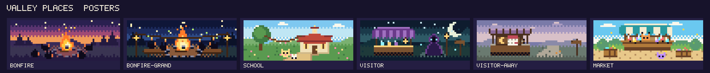

- **Status:** draft
- **Requested:** 2026-10-31: the bonfire, the School, the weekly visitor and the Market, in the direction of the expedition map art; try variations.
- **Source:** `apps/activity/src/sprites/concepts/valley-posters.ts` (draw it with `pnpm art valley-posters`)
- **Sheet of:** `e7a08c426a3f`
- Direction "poster": six 64x24 banners, one per place state, each with its own time of day (dusk, night, morning, twilight, grey dawn, afternoon).
- Places: the bonfire (and a grander later level), the School, the weekly visitor (here and away), the Market (the shard broker). Designs are on the ccr-93a1de17-yutb1a branch, docs/design/valley/systems/.
- Needs before use: the valley places in the content, each place screen head using its banner; the visitor-away banner shows between Sunday and Thursday.
- Each banner uses up to 16 colours (the studio cap for scenes).
- Creatures in the banners are silhouettes or simple blobs, not species: swap in the player's own when the screen can.

| Code | Kind | Role | Status | Idea |
| --- | --- | --- | --- | --- |
| `bonfire` | banner |  | draft | A warm dusk: a fire in a ring of stones in the middle of the valley, four resting creatures as silhouettes with a firelight rim, sparks rising into a plum sky. |
| `bonfire-grand` | banner |  | draft | The grand hearth at night: a wider stone ring and a taller fire, a log bench each side with creatures on it, lantern posts with a string of lanterns, fireflies. |
| `school` | banner |  | draft | A bright morning: the schoolhouse with a bell tower at the end of a path, bunting from the tree, and a little graduate in front wearing a pink ribbon. |
| `visitor` | banner |  | draft | A blue-green twilight under a crescent moon: the hooded stranger with glowing eyes and a lantern staff beside his striped stall of glowing jars. |
| `visitor-away` | banner |  | draft | The same stall on a grey-lilac morning: awning furled, lantern dark, a leaf on the counter and a sign with a moon and a calendar page, one day marked. |
| `market` | banner |  | draft | A golden afternoon: a teal and cream stall where a round orange shopkeeper sells shards (red, yellow, cyan, violet), crates of them in front and a customer with a coin. |

## The School's visiting teacher

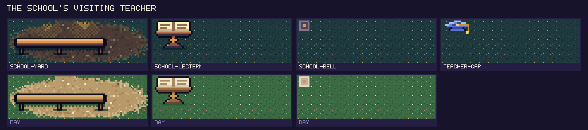

- **Status:** draft
- **Requested:** 2026-11-03 (via the valley session, Misa's round 22 decision): show the visiting teacher with no banner: the bell swings, a lectern at the door, a bench of students, a teacher prop.
- **Source:** `apps/activity/src/sprites/concepts/valley-school.ts` (draw it with `pnpm art valley-school`)
- **Sheet of:** `764ab7d8ac30`
- Lead's review (2026-11-03): the yard's window light is kept faint on purpose, because the School sprite throws its own spill and students on the bench cover most of it. Push it brighter if it should read on its own. Talent icons need no new art: the four combat v2 role glyphs already ship (Setter `mark`, Payoff `sparkle`, Guard `shield`, Support `ability`).
- Spec: valley/systems/school.md, "As decided (round 22)": no banner; the bell swings and a lectern appears at the door before the teacher comes, the teacher stands at the lectern Monday to Wednesday, students sit on a bench in front (empty seats show there is room to join), at dusk the windows light.
- Lectern: the camp's `lectern` (48x50) is as big as the School itself, so beside a 16x16 teacher it is too big for the yard; `school-lectern` (22x17) is a small stand for the yard. Its foot is (10, 15) in its own pixels; the game puts that point at yard (73, 14). The teacher stands left of it, feet (62, 14): the sprite's top-left is (54, -1). Draw order: yard, lectern, teacher, then the students.
- Yard: 80x24 (wider than the 64 asked: the bench takes the left 56 px and the right 24 px are the clear spot for the lectern and the teacher). Placed so the yard's x 31 and 32 are under the School door (yard top-left = School top-left + (-2, 38)), top row against the door steps; the two warm pools are under the School's two windows (yard x 21 and 42). Four seats on one long bench, 13 px apart. A creature is drawn with its sprite's bottom row (its feet, the last row, 15) on the seat row, so its top-left is (seat x - 8, 12 - 15): seat feet points (9, 12), (22, 12), (35, 12), (48, 12) in yard pixels (plank top rows 11 and 12; the front face below is clear). Nothing is drawn above row 10 over the bench, so the seats are unobstructed; an empty seat is just bare plank. Day: bare dirt, pebbles and grass tufts at the edge, no light.
- Bell: three 6x6 overlays for the School's cupola opening; top-left (27, 7) on the 60x50 School sprite. `school-bell` is the School's own pixels at rest (a test checks it against `valley-glow.ts`); `left` and `right` tilt the 2x2 bronze bell one pixel across and one row apart. Play rest, left, rest, right while the bell rings. The day alt uses the School's own day colours for the same keys.
- Teacher cap: a navy mortarboard (a flat diamond board with a lighter top face and an ink underside), a small cap under it, a gold button, a gold cord to the right corner and a gold tassel hanging beside the head. It is fixed colour (not item-tinted). How it plugs in: a new hat class `mortarboard` in `worn-sprites.ts` would hold the board and cap as a `HalfShape` (rows 0 to 5, left half, mirrored; the top face of the board in rows 1 and 2 is drawn a little off-centre and the cord crosses row 2, so a mirrored version makes those two rows symmetric and leaves the cord to the patch) and `wearing()` would paint the tassel patch (the three cord and tassel columns, x 13 to 14, rows 2 to 7 of the cap) on the right as a second small shape; a hat that is taller than the usual rule puts its top row two rows above the head top (the usual rule puts its bottom row one under the head top), so ears stay visible beside the board. Face rows 8 to 10 are never painted; the tassel is the only part that can reach row 8 and 9, at x 13 to 14, beside the cheek.
- The variants of `teacher-cap` show it on three shipped creatures: Splashet (round), Sproutle (leaf ears) and Zipmouse (small, ears and a tail on the right, so its tassel hangs on the left). They are composed in code from the shipped sprites, not drawn by hand.

| Code | Kind | Role | Status | Idea |
| --- | --- | --- | --- | --- |
| `school-yard` | free |  | draft | The ground in front of the School door: a trodden dirt yard, 80x24, with one long bench of four seats, 13 px apart, facing the School. Seat feet points (9, 12), (22, 12), (35, 12), (48, 12); the clear spot for the lectern (foot (73, 14)) and the teacher (feet (62, 14)) is on the right. Night: warm stepped light from the two windows on the dirt. Day: bare dirt with pebbles and grass tufts at the edge. |
| `school-lectern` | free |  | draft | A small lectern for the yard, 22x17: an open book on a slanted board, a short post and a flared foot; the teacher stands to its left. Foot point (10, 15). The camp lectern stays for places where a big desk fits. |
| `school-bell` | free |  | draft | The School's bell at rest, 6x6 over the cupola opening at (27, 7) on the School sprite; `left` and `right` are the two swung frames. |
| `teacher-cap` | free |  | draft | The teacher's mortarboard with a gold tassel, 16x8, worn over the head top of a 16x16 creature (top row two rows above the head top). Light blue rim on the board's top edge and a lighter underside line and band keep it readable on dark ground. Variants: worn by Splashet, Sproutle and Zipmouse (small head: the cap sits one row lower and drops the cap's under row (row 4, the cap band under the board) so the ears show above the board). |

## Valley sky, day and night

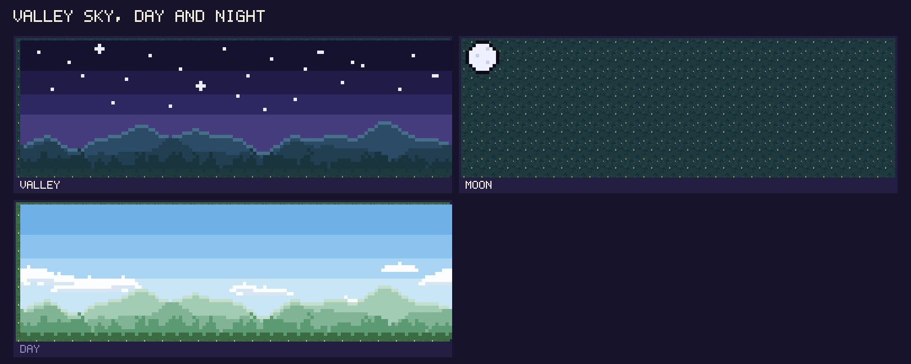

- **Status:** draft
- **Requested:** 2026-11-03 (Q50, via the valley session): place screens drop the poster; Misa likes "the added depth of having a sky in the background ... We'd just need the proper sky images. Eventually the sky backdrop could vary based on location."
- **Source:** `apps/activity/src/sprites/concepts/valley-sky.ts` (draw it with `pnpm art valley-sky`)
- **Sheet of:** `ba9100228e45`
- Used by the valley prototype's place screens (`apps/activity/src/proto/valley/glow-scene-art.ts`, `skyPlacements`, poster mode `sky`, branch `ccr-93a1de17-yutb1a`).
- One strip, 128 x 40, tiles sideways (see the `seam` and `seam-day` rows: the join is in the middle). Top row is one flat colour, repeat it upward behind the HUD. Bottom row is the grass colour of the world-map tile.
- Main palette is night (4 bands, stars), `alts.day` is the same pixels: stars vanish into the band, clouds appear. Clouds sit across the seam on purpose. The optional `moon` sprite is placed once by the scene, never tiled.
- Per-location variants (forest, coast, mountains) later: same bands, a different horizon in the bottom rows.

| Code | Kind | Role | Status | Idea |
| --- | --- | --- | --- | --- |
| `valley` | free |  | draft | A sky strip with far rolling hills and a hazy treeline at the bottom that meet the grass. Night: violet bands and stars. Day: blue bands and a few clouds. |
| `moon` | free |  | draft | An optional small moon the scene places once in the night sky (not part of the tiled strip). Hidden by day. |

## Void, a raid boss, three foes and two floor bosses

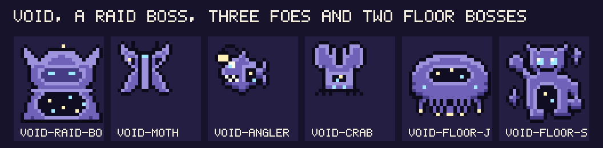

- **Status:** draft
- **Requested:** 2026-10-31: a Void raid boss, dungeon foes and dungeon bosses.
- **Element:** void
- **Source:** `apps/activity/src/sprites/concepts/void-foes.ts` (draw it with `pnpm art void-foes`)
- **Sheet of:** `e086da4e04e7`
- Needs before use: the Void element in the content, names, stats, gimmicks, lore and a place.
- Working names and ideas are in docs/compendium/bosses.md and dungeon.md ("Concept, not shipped").
- 2026-10-31 (Misa): void-crab, "More emphasis on the claws"; redrawn with big raised claws that dominate the silhouette.
- 2026-10-31 (Misa): void-floor-sentinel, "Make it more animate"; redrawn as a living stone guardian (horns, face, one fist raised, mid-step).
- 2026-10-31 (Misa): void-lantern, "You don't generally fight lanterns (inanimate)"; replaced by void-angler, a living fish that carries a lantern lure.
- 2026-10-31 (Misa): void-moth, "Make it more pointy and elegant"; redrawn with swept, pointed wings, a slender body and antennae.

| Code | Kind | Role | Status | Idea |
| --- | --- | --- | --- | --- |
| `void-raid-boss` | boss |  | draft | Hollow Crown: a huge hooded giant under a crescent crown, two glinting eyes in the hood and a cloak that opens on a starfield. |
| `void-moth` | foe |  | draft | Dusk Moth: swept, pointed wings with a starry window each, a slender body and long curved antennae; it eats light. |
| `void-angler` | foe |  | draft | Gloam Angler: a round deep-dark fish with a starry window on its flank, a glinting eye, a toothy mouth and a lure on a stalk that holds one warm star; it hides what its light touches. |
| `void-crab` | foe |  | draft | Drift Crab: a crab with two huge raised claws that fill the silhouette, a starry window in its shell and glinting eyes; it tucks in and hides. |
| `void-floor-jelly` | boss |  | liked | Lantern Drifter: a floating bell with a starry window, two glinting eyes and trailing tendrils tipped with stars. |
| `void-floor-sentinel` | boss |  | draft | Dim Sentinel: a living stone guardian with horns and glinting eyes, one fist raised and one hanging, mid-step, a doorway of night in its belly and two shards orbiting it. |

## Void gear: tint, plain pieces, a set, a shard

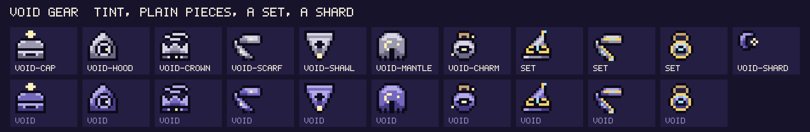

- **Status:** draft
- **Requested:** 2026-10-31: design Void gear.
- **Element:** void
- **Source:** `apps/activity/src/sprites/concepts/void-gear.ts` (draw it with `pnpm art void-gear`)
- **Sheet of:** `c0d5c4c25d5e`
- Needs before use: the Void element in the content (an element tag, a Void Hat, Scarf and Charm at three tiers in gear.json, the set in gear-sets.json, a Void shard in the part kinds), the tint in TINTS and SET_TINTS (gear-sprites.ts), names and flavour confirmed, and the charm flair in item-flair.ts.
- Proposed tint: t #7468bc, u #463c86, h #b4aae8 (the Void creatures, a little lighter so a dark item stands out on the panels).
- 2026-10-31: Misa liked the other eight; for the Starkeeper's set (hat, scarf, charm) he said it read pure purple and yellow and asked for a small accent toward the stars. Added a fixed pale starlight cyan `#9fe8ff` (not tinted) on the stars and a glint on the trim; silhouettes and gold trim kept. Those three are draft again.
- The charm is the shared trail-charm with a Void flair (the variant); every other piece is its own look, as the shipped hats and scarves are.

| Code | Kind | Role | Status | Idea |
| --- | --- | --- | --- | --- |
| `void-cap` | item |  | liked | Dusk Cap: a round cap with a star on a stalk and a band of starry window. |
| `void-hood` | item |  | liked | Gloaming Hood: a pointed cloth hood; inside it shows a round window of night with one star. |
| `void-crown` | item |  | liked | Stargazer's Crown: a three-point crown with a tilted ring in orbit around its tips and a star in its window. |
| `void-scarf` | item |  | liked | Twilight Scarf: a soft wound scarf with a star on the band and one long tail, notched at the end. |
| `void-shawl` | item |  | liked | Nightfall Shawl: a triangle of cloth hanging to a point, a lit window across the chest, a star at the tip. |
| `void-mantle` | item |  | liked | Stargazer's Mantle: sloping shoulders, a collar, a crescent clasp, a front seam and a scalloped hem. |
| `void-charm` | item |  | liked | Starwell Charm: the shared trail-charm with a Void flair (a window with a star, and a glint); the variant is the plain shipped stone. |
| `void-set-hat` | item | set | draft | Starkeeper's Hat: a tall pointed hat with a gold star at the tip and a gold band round a starry window. |
| `void-set-scarf` | item | set | draft | Starkeeper's Loop: a gold-striped wound scarf with a long tail, a star on it and a gold tassel. |
| `void-set-charm` | item | set | draft | Starkeeper's Lens: a gold ring, like a lens held up to the sky, with a starry window inside. |
| `void-shard` | part |  | liked | Void shard: a crescent-shaped crystal with a star caught in its hollow. |

## Void place, the Quiet Verge (banners)

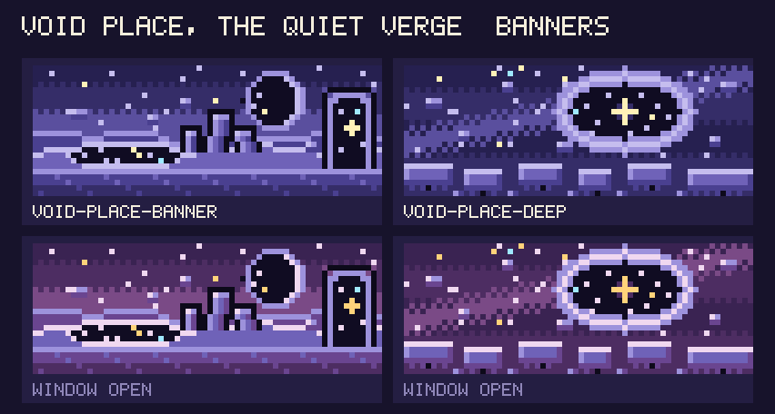

- **Status:** liked
- **Requested:** 2026-10-31: design a Void area that can be explored (banner and place).
- **Element:** void
- **Source:** `apps/activity/src/sprites/concepts/void-place.ts` (draw it with `pnpm art void-place`)
- **Sheet of:** `daa071502d5a`
- Misa liked both banners on the art review page (2026-10-31).
- Place concept: docs/compendium/places.md, "Quiet Verge" (working name). Concept, not shipped.
- Needs before use: the Void element in the content (element chart, marks, creatures from void.ts with names, stats, lore, shiny palettes), an entry in destinations.json with these palette colours and the deeper area, an access rule, journal pages, push-on flavour and a glossary entry, then the compendium entry moved out of concept.
- To ship: move the banners into data/ (a void-banner-sprites.ts registered in BANNER_SPRITE_DATA under the destination id) and delete this set.
- Each banner uses 11 colours or fewer (the studio cap), where shipped banners use 12 to 14.

| Code | Kind | Role | Status | Idea |
| --- | --- | --- | --- | --- |
| `void-place-banner` | banner |  | liked | The Quiet Verge: a dusk plain of lilac dust, a still pool that holds the stars, leaning stones, a dark moon and a stone arch with one warm star at the far end. |
| `void-place-deep` | banner |  | liked | The far side: the ground ends, stepping stones cross the open sky, and a great ring hangs ahead with one warm star at its middle. |

## Void creatures, two stages

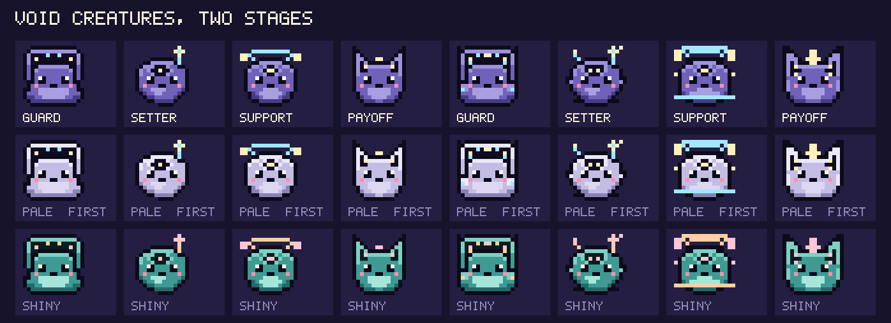

- **Status:** liked
- **Requested:** 2026-10-30: imagine the Void element on creatures; four creatures, one per role, no names or stats.
- **Element:** void
- **Source:** `apps/activity/src/sprites/concepts/void.ts` (draw it with `pnpm art void`)
- **Sheet of:** `bf4737245b93`
- Misa chose the dark purple body over the pale first draft and said they look pretty good (2026-10-30).
- Needs before use: the Void element in the content (element chart, marks, a place), names, stats, lore, shiny palettes.
- The payoff's ear windows are the faintest detail; look again when it is promoted.

| Code | Kind | Role | Status | Idea |
| --- | --- | --- | --- | --- |
| `void-guard` | creature | guard | liked | An eclipse hood: a wide dark crescent of night sky over a sturdy body, like a shield. |
| `void-setter` | creature | setter | liked | A floating wisp with a feeler that ends in a star: it points at the boss and marks it. |
| `void-support` | creature | support | liked | A small planet with a ring for a halo and two moons in orbit: it lifts its neighbours. |
| `void-payoff` | creature | payoff | liked | A lynx of the night: tall ears that are windows full of stars, a star-tipped crest. |
| `void-guard-2` | creature | guard | draft | The Eclipse Hood grown: horned corners, a second star and a cyan corona in the window, raised shoulder plates with a glint. |
| `void-setter-2` | creature | setter | draft | The star-feeler wisp grown: a second small feeler, a wider third-eye window with two stars, side wisps and a trailing tail. |
| `void-support-2` | creature | support | draft | The ringed planet grown: a double halo, bigger moons, a third moon and the ring wrapped round its belly. |
| `void-payoff-2` | creature | payoff | draft | The night lynx grown: wider ear windows with two stars, a star-shaped crest and a cheek ruff. |
